# Madalone's Defolded Circle 3 — Custom Screensaver Firmware

**Custom firmware. Voids the warranty.** 

Fork of [`unfoldedcircle/remote-ui`](https://github.com/unfoldedcircle/remote-ui) for the **Unfolded Circle Remote 3**, replacing the stock analog-clock charging screen with a GPU-accelerated screensaver system.

Five themes, nine screen-off animation styles, full DPAD/touch interaction, zero Home Assistant dependency, clean fall-back to stock UI on install failure. It also adds rows to the Power Saving, Sound & Haptic and User interface settings, and Reconnect and Diagnostics to the Wi-Fi sheet (see [Features](#features)). It needs firmware 2.12.0 or newer.

[**▶ Watch the demo on YouTube Shorts**](https://youtube.com/shorts/jFoOmoNNWwU) — 30-second tour of Matrix rain in action on my UC3.

| Matrix Rain | Starfield | Minimal | Analog | TV Static |
|:-----------:|:---------:|:-------:|:------:|:---------:|
| 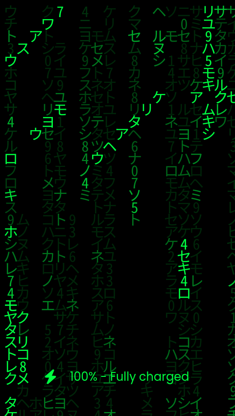 | 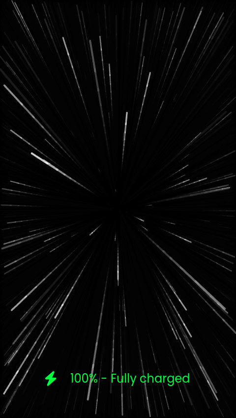 | 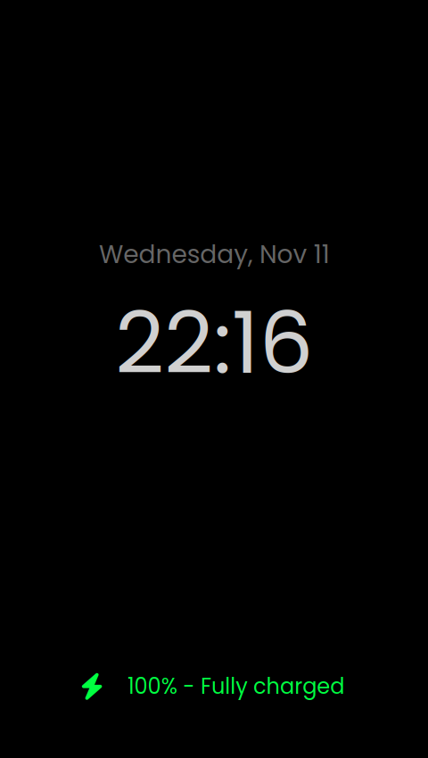 | 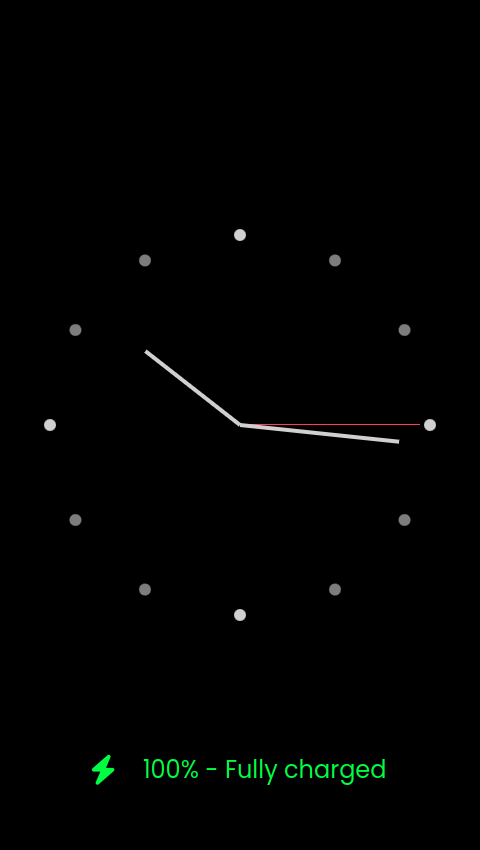 | 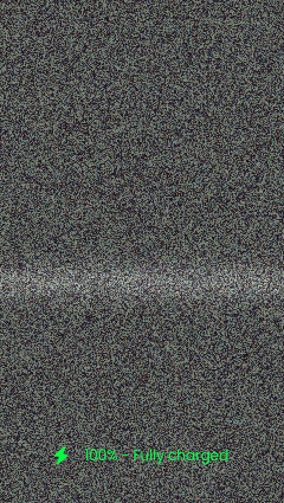 |

---

## Features

The fork is Unfolded Circle's UI v0.84.0, the UI of firmware 2.12.0, with the changes and additions below. Settings are named as the remote shows them: "Settings → Power Saving → Keep awake while watching/listening" is the Power Saving entry of the Settings menu, then the row with that title. A default is the value a setting has until you change it.

### The screensaver

The screensaver replaces Unfolded Circle's analog charging clock. Its settings are a page stock UC doesn't have: **Settings → Screensaver** (bolt icon, between User interface and Touch Slider). The page starts with the Theme picker, then come the clock and battery rows, the rows of the chosen theme, and at the end the rows that decide when the screensaver opens and closes (on Matrix also its d-pad and touch rows, and Atlas profiling overlay as the last row). Every control on the page that isn't greyed out can be reached with the d-pad; the Hidden messages words are typed on the touch screen. [`SCREENSAVER-README.md`](SCREENSAVER-README.md) describes every setting.

**Themes** (the Theme picker; Matrix by default):
- **Matrix rain** — falling characters drawn on the GPU, with rain in every column and row (since v1.6.2). **⚠ Over 100 tunables is enough rope to make it look stunning, subtle, chaotic, or downright unreadable.** Every combination is legitimate and intended — the defaults are a conservative starting point, but every slider, toggle, and colour picker is exposed because the point of the mod is to let you push it wherever you want.
  - **Look:** Color (6 solid colours: green, blue, red, amber, white, purple; 3 gradients: rainbow, rainbow+, neon; green by default), Characters (Kana, ABC, 01, 123; ABC by default), Font size, Animation speed, Column density, Trail length, Trail fade and Direction (8 directions; down by default).
  - **Glow:** Invert trail (off by default), Head glow (on), Glow fade (how long characters keep glowing after the rain has passed) and Depth glow (off).
  - **Rain layers** (off): three grids of rain at different sizes and speeds; the bright part of the nearer rain hides the rain behind it. **Color layers** (off): each stream is tinted by its depth.
  - **Glitch effect** (on): Column flash, Column stutter, Reverse glow, and Direction change (on), which throws off short glitch trails. **Chaos events** (off): random events from time to time, each with its own switch. Surge (flash), Scramble (mutate), Freeze (stutter), Square burst, Ripple and Scatter (burst) are on; Screen wipe is off and has its own Wipe speed.
  - **Hidden messages** (on, but the list starts empty): your own comma-separated words, written into the rain. **Subliminal messages** (off; the row appears once Hidden messages has words): the words flash up briefly.
  - **Tap effects** (see Interactive below). The last row, **Atlas profiling overlay** (off), shows build timings for developers.
  - **Auto-rotate** (off) — the rain direction sweeps round the full circle with curved trails and reaches every row and column on the way round. The rotation speed is a slider, so the sweep is **as slow or as fast as you want**: glacial-and-hypnotic on a docked remote, or a blur at the top end. "Trail bend" sets how much the trails curve.
  - **Manual direction control** — the d-pad (with the volume and channel keys as diagonals) or the touch zones turn the rain at any time, also during Auto-rotate. The rain bends to the new direction instead of starting over.
- **Starfield** — a warp-speed star tunnel: Animation speed, Star density, Star size and Trail length (10–100, default 50 each), and Star color (solid colours or the three gradients; white by default).
- **Minimal** — a large digital clock under the date: 24-hour clock (on by default), Font (Poppins or Space Mono), Time color, Date color, Clock size (48–144, default 96) and Date size (16–48, default 28).
- **Analog** — Unfolded Circle's own analog clock (12 dots, off-white hour and minute hands, red second hand) as a theme, with its own screen-off effect: the hands sweep to 12, then drop to 6 while the screen dims to black. "Shutdown hands" picks All three hands (the default) or Minute + hour only.
- **TV Static** — CRT noise drawn by a GPU shader: Snow intensity, Snow size, Scanline strength, Scanline roll speed, Chroma bleed (VHS), Rolling tracking bar with its speed, and Tint. Under "Channel flash": Auto flash bursts (on by default) every Flash interval (3–120 s, default 20, varied by up to half each time), with Flash duration and Flash brightness. "Flash on tap" (on by default) flashes the screen when you press a d-pad arrow or a volume or channel key while "DPAD interactive" is on; a tap on the screen doesn't flash it.

**Overlays:**
- **Clock** on Matrix, Starfield and TV Static ("Show clock", off by default; Minimal and Analog are clocks themselves): Position (Top, Center or Bottom), 24-hour clock, Color, Font, Size, "Show date" with its own Date size and Date color, and "Charging only" (off by default; shows the clock only while the remote is on the dock or charger).
- **Battery** on every theme ("Show battery", on by default): a bolt and the level in five colours (green from 86 %, then light green, yellow, orange, and red below 16 %), "Text size", and "Charging only" (on by default: shown only while the remote is on the dock or charger). Its texts ("…% - Charging", "100% - Fully charged") are in English on every UI language.

**When it opens:**
- When you put the remote on the dock or charger, with the dock chime (see [Dock chime and sounds](#dock-chime-and-sounds)).
- When the remote wakes up on the charger while it is charging, from display-off or standby (not when the screen was only dimmed). Lifting a charging remote whose display is off can count as such a wake: in 13 recorded lifts on the maintainer's Remote 3 the remote woke a few seconds before it reported that it had left the dock.
- When the UI starts while the remote is on the charger: after 2 s, without a chime.
- "Run after dismissal while docked" (5–120 s, step 5, default 60; no off position): on the dock the screensaver comes back that long after it closes, even while you use the remote. Lifting the remote cancels it, and if the time runs out while you reorder a page, it doesn't come back.
- "Idle screensaver" (off by default): away from the charger it opens after "Idle timeout" (15–55 s, step 5, default 45) without a button press, a screen touch or the touch slider. After the UI starts away from the charger, that countdown first runs once the screen has come back from dimmed or off, the remote has been on the charger and left it, or "Idle screensaver" has been switched on.

**How it closes:**
- A tap. With "Double-tap to close" on (the default), two taps within 0.3 s close it, and on Matrix a single tap plays the tap effects instead. With it off, a single tap closes it, as on stock UC. On Matrix with "Touch directions" on, it is the fourth quick tap in the centre of the screen that closes it.
- A button. With "DPAD interactive" on (the default), the d-pad (arrows and OK) and the volume and channel keys don't close it, on any theme: on Matrix they steer the rain, on TV Static the arrows and the volume and channel keys flash the screen (with "Flash on tap" on), and on Starfield, Minimal and Analog they only stop a screen-off animation that is playing (with "Remember direction" on, the arrows and the volume and channel keys also store a direction that the next Matrix screensaver opens with). The switch is shown only while Matrix is the theme: to make those keys close another theme, pick Matrix, turn "DPAD interactive" off, then pick your theme again. Every other button closes the screensaver.
- A wake or a lift, as "Close on wake" decides (below).
- Stock UC closes its charging screen on any tap, on any of its buttons and whenever the remote leaves the charger.

**Close on wake** (Unreleased: up to v1.6.3 an on/off switch) has three choices, each with its own help line:

| Never (the default) | Undocked | Always |
|:-------------------:|:--------:|:------:|
| 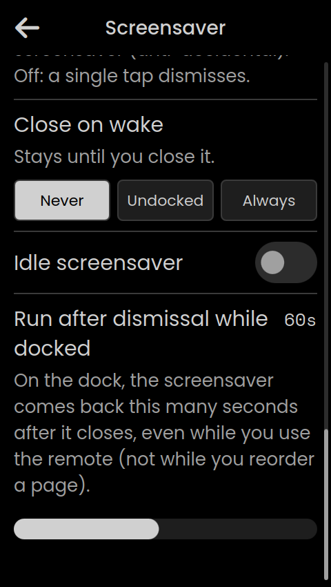 | 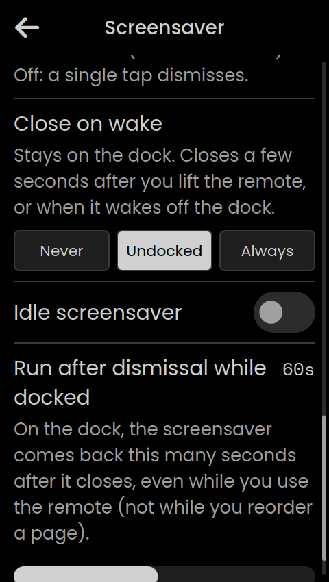 | 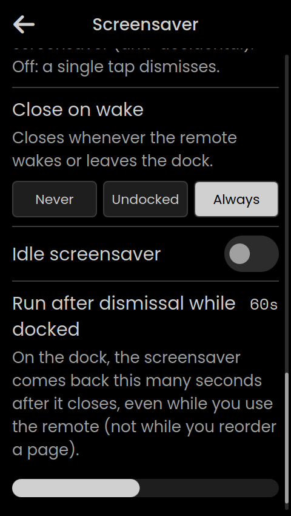 |

- **Never** — "Stays until you close it." Neither a wake nor lifting the remote off the dock closes it.
- **Undocked** — "Stays on the dock. Closes a few seconds after you lift the remote, or when it wakes off the dock." A wake while the remote is on the charger (a touch, a bump of the nightstand) leaves it showing. It closes when the remote reports that the charger is gone, and when the remote wakes while no charger is reported. A screensaver that is still opening at that moment is stopped, so it can't open in your hand (Always lets it open, as v1.6.3 did).
- **Always** — "Closes whenever the remote wakes or leaves the dock." Every wake closes it, on the dock too, and so does the report that the charger is gone. Closed on the dock, it comes back after "Run after dismissal while docked". This is the old switch's "on".
- **The lift delay.** The remote learns that it has left the dock only from its battery check, which runs about every 5 seconds and reports changes only. On the maintainer's Remote 3 on a Qi pad, that report came 2.3–4.6 s after a lift woke the remote (13 lifts, median 3.3 s). With Undocked the screensaver stays in your hand until then, and a button pressed in that time goes to the screensaver: it closes the screensaver (except the d-pad, volume and channel keys while "DPAD interactive" is on, see "How it closes" above), and your button mappings don't run. That last part is worked out from the code and not yet tried on a remote.
- **Qi pads.** When a Qi pad stops charging (seen at 80 % and when full), the remote reports the charger gone while it still lies on the pad, so Undocked and Always close the screensaver then, and a bump doesn't bring it back until the remote reports the charger again (with Never it stays).
- Your setting carries over: the old switch off becomes Never, on becomes Always. Back on v1.6.3, Undocked reads as the switch on.
- Stock UC closes its charging screen whenever the remote leaves the charger. Since v1.2.2 this fork's default (now Never) keeps it open.

**Interactive (Matrix theme):**
- **D-pad** ("DPAD interactive", on by default): the arrows turn the rain that way, and the volume and channel keys give the four diagonals. OK sets off a chaos burst (with Glitch effect and Chaos events on) or else a flash (with Glitch effect on; nothing with it off), OK twice returns to the set Direction or to Auto-rotate, and holding OK slows the rain to a third until you let go. "Remember direction" (on) opens the screensaver with the last direction you picked.
- **Touchbar speed** (on, under DPAD interactive): sliding a finger along the touch slider changes the Animation speed (the direction that turns the volume down makes it faster). On Starfield the touch slider always changes the Star density. A red label shows the new value for a moment.
- **Touch directions** (off): the screen is a 3×3 grid, and tapping one of the 8 outer zones turns the rain that way and fires the tap effects. Quick taps in the centre: the first two fire the tap effects and also act as presses of OK (one on its own does what a single OK press does; two within 0.3 s return to the set direction), the third returns to the set direction and the fourth closes the screensaver. "Swipe speed" (on, under Touch directions): a swipe up or down changes the speed (up is faster); this works on Starfield too while Touch directions is on. Touch directions is meant instead of DPAD interactive, but turning one on in Settings doesn't turn the other off: with both on, taps use the zones, the d-pad, volume and channel keys still work as under D-pad, and the touch slider no longer changes the speed.
- **Press and hold** the screen: the rain slows down after 0.5 s and stops after 1.5 s, and carries on when you let go.
- **Tap effects** ("Enable tap effects", on): Scatter burst, Flash shockwave, Character scramble, Stream spawn, Show message, Square burst and Ripple (all on), and Screen wipe with its own Wipe speed (off), each with its own switch, plus "Randomize" (off) with a Chance. Without Touch directions a single tap fires them only while "Double-tap to close" is on (0.3 s later, if no second tap comes); with it off a single tap closes the screensaver.
- While the screensaver shows, the touch slider never changes the volume, playback position, brightness or cover position of the device behind it. A slide already under way when the screensaver appears ends there, as if you had taken your finger off: the value the slider showed is sent once (unless the device already has it), and nothing after it (Unreleased; before, that slide kept changing the device).

Matrix, Starfield and TV Static stop animating while the display is off and carry on when the remote wakes.

### Screen-off animations

While the screensaver shows, a short animation can play just before the display switches off. The settings are on **Settings → Power Saving**, below "Display off timeout":
- **Screen off animations** (on by default): the master switch.
- **Fire when undocked** (off by default): also play it away from the charger, for example on the idle screensaver. It doesn't open the screensaver.
- **Style** — nine choices:
  - **Fade** — monotonic black ramp. Clean dim-to-nothing, safest baseline.
  - **Flash** — brief white full-screen pulse, then a fade to black. Classic "TV zap off".
  - **Iris** — an oval black mask, stretched to the screen's shape, closes from the edges to the centre. Camera-shutter feel.
  - **Wipe** — solid black rectangle sweeps top-to-bottom like an old film projector.
  - **Wave** — soft cyan gradient wave travels downward, dimming everything behind it.
  - **Genie** — the picture shrinks and slides toward the bottom of the screen, like the macOS Genie effect without its curve.
  - **Pixels** — the picture breaks into bigger and bigger blocks (0.5 % → 8 % of the screen width), then fades to black.
  - **Dissolve** — the picture blends into white noise, turns into pure noise, then fades to black.
  - **Theme** (the default) — the theme's own effect. **TV Static:** snow and scanlines collapse into a bright horizontal line, the line shrinks to a dot, and the dot fades to black (800 ms, then 500 ms of black). **Analog:** the hands sweep to 12, then drop to 6 while the screen dims (600 + 400 ms, then 300 ms of black). Matrix, Starfield and Minimal have no effect of their own, so with "Theme" they play nothing.
- **Animation length** (300–4500 ms, step 100, default 800): for the eight drawn styles; hidden while Style is Theme. It is shortened when the display turns off sooner, and skipped when less than 300 ms is left.

The animation starts while the screen is dimmed and ends 250 ms before the earliest moment the display can switch off for your "Display off timeout" (the fork knows that moment from the core's schedule, measured on 2026-11-02). After a visible animation the remote switches the display off at once, unless you touched it during the animation. Without an animation the display goes off on the core's own schedule.

| Settings → Power Saving (Pixels picked here; the default is Theme) |
|:--:|
| 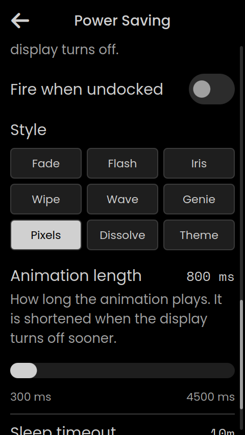 |

### Dock chime and sounds

On **Settings → Sound & Haptic**:
- **Dock chime**: twelve chimes for putting the remote on the charger, instead of Unfolded Circle's single charge sound. Six short tones (0.25–0.5 s): Warp (the default), Ascend, Bell, Chord, Pulse and Zap. Six longer ones (0.9–2.9 s): Pwr Down, Pwr Hold, Pwr Up 1, Pwr Up 2, TOS and TOS Long. Picking one plays it. The chime follows "Sound effects" and "Sound effects volume", and doesn't play when the UI starts while the remote is already on the charger.
- **Chime after screensaver** (on by default): the screensaver appears at once and the chime plays when it is on screen. Off: the chime plays first, and the screensaver starts to load once it has ended (after the chime's length plus 0.1 s, and at least 0.35 s). With it on, the chime plays only when docking opens the screensaver: putting the remote back on the dock while the screensaver is still showing plays no chime (Unreleased; before, that chime played at a later, unrelated opening of the screensaver).
- **The sounds themselves.** Firmware 2.9.2 stopped giving a custom UI the path to Unfolded Circle's sound files, so the install bundle brings its own click, low click, confirm and error sounds and the 12 chimes. They are not UC's originals: the four UI sounds and the six short chimes are CC0 sounds made by [`tools/gen_sounds.py`](tools/gen_sounds.py). When the firmware does give the path, the UI reads the sounds from there instead.

| Settings → Sound & Haptic |
|:--:|
| 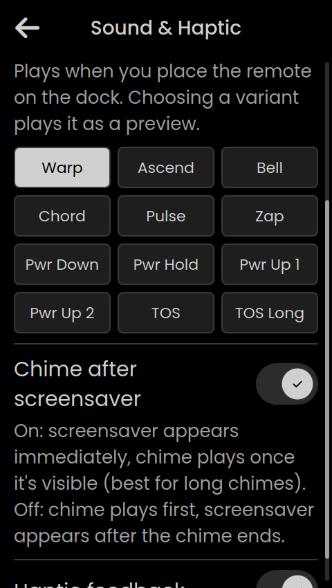 |

### Status icons

- **Home screen status bar** (no setting): the WiFi icon is always there, with one to three bars for the signal and a red line through it when WiFi is down. Stock UC shows it only when WiFi is down or has no signal.
- **Show WiFi indicator everywhere** (Settings → User interface; on by default): the same icon in the title row of every device and activity screen. Off: there the WiFi icon appears only when WiFi is down or has no signal (stock UC also shows it for a weak signal).
- **Device and activity screens** (no setting): such a screen covers the status bar, so its title row repeats three of its signs: the dots while integrations connect, a red dot when the UI has lost its connection to the remote's core, and a yellow download icon when a software update is available.
- The battery icon next to them is Unfolded Circle's own "Show battery indicator everywhere" (same page, off by default).

| Settings → User interface | A device screen with both "everywhere" switches on |
|:--:|:--:|
| 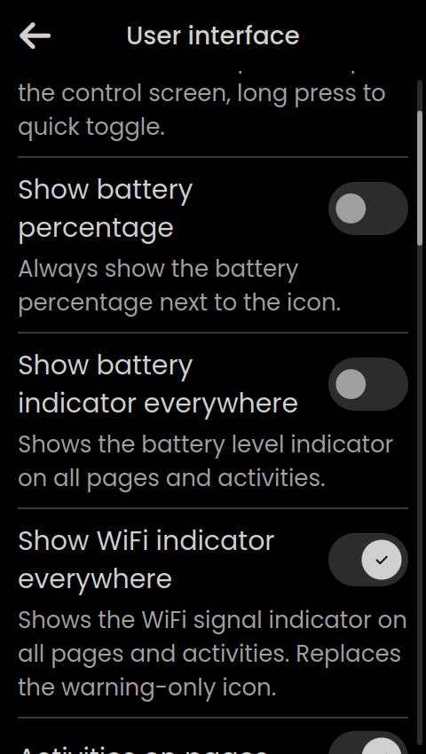 | 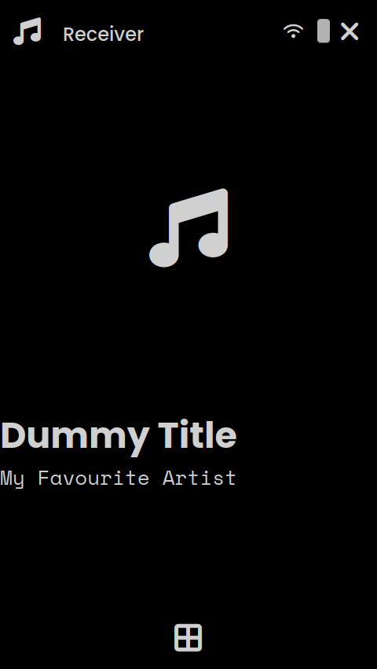 |

The desktop simulator has no WiFi, so the WiFi icon in these pictures shows no real signal.

### Wi-Fi

On **Settings → Wifi & Bluetooth**, tap the network the remote is connected to:
- **Reconnect** (shown while connected): reconnects to the access point without forgetting the network, then refreshes the link details after 2.5 s.
- **Diagnostics** opens the "WiFi diagnostics" sheet: a "Signal history" graph of the last 60 readings, with dashed lines at -60, -76 and -84 dBm; Signal (dBm), Link speed, Throughput (only when the remote reports one), BSSID and Channel; Drops since start-up, Current session and Since last drop; and "Reset counters", which asks first. While the sheet is open it reads the signal every 5 s; otherwise every 30 s, while the remote is connected and the display is on. The history and the counters start again when the UI restarts.

On **Settings → Power Saving**:
- **Keep WiFi connected in standby** is Unfolded Circle's own switch. Stock UC shows it on a Remote 3 only when the firmware enables it; the fork always shows it. On, it keeps WiFi connected while the remote sleeps, for a faster reconnect, at some battery cost. "Suppress phantom wake-ups" (below) is meant for the wakes that network traffic can then cause.

The 30-second WiFi status check and the network scans of the Wi-Fi page and of the first-time setup pause while the display is off, and continue when it comes back on.

The desktop simulator has no WiFi, so there are no pictures of these sheets.

### Power Saving

The first rows of **Settings → Power Saving**:
- **Suppress phantom wake-ups** (off by default): when the remote wakes from display-off or standby and nothing follows within "Grace window after wake" (100–5000 ms, step 100, default 500) — no button, screen touch, touch-slider contact, charger change or device command — it is sent straight back to sleep. "Recent-input lookback" (0–2000 ms, step 50, default 500; 0 shows as Disabled) skips that check when any of those came just before the wake. It is meant for wakes that network traffic causes while "Keep WiFi connected in standby" is on.
- **Keep awake while watching/listening** (off by default): the remote doesn't go into standby (its "Sleep timeout" is held off) while a media player on one of your pages, groups or activities is playing, and for "Idle timeout after last button" (30 s to 5 min, step 30 s, default 60 s) after you send a playback, volume, mute, cursor, channel, back, home, menu, guide, info or digit command, or an IR code. "Only when on charger or dock" (on by default) limits it to the charger. In a test on firmware 2.9.1 (2026-05-04) the display still dimmed and switched off after "Display off timeout"; only the standby was held off.
- **Retry commands after wakeup** is Unfolded Circle's row (0–10 s, default 2). Stock UC opens this retry window only after a wake from standby. The fork also opens it after a wake from display-off, the state the Remote 3 usually sleeps in, so a button press that wakes the remote is retried within the set time.

| Suppress phantom wake-ups (on) | Keep awake while watching/listening (on) | Its rows, then Keep WiFi connected in standby |
|:--:|:--:|:--:|
| 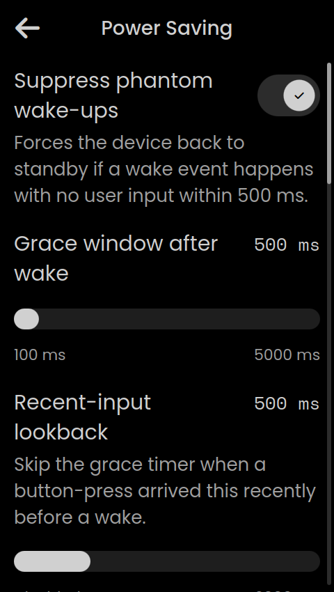 | 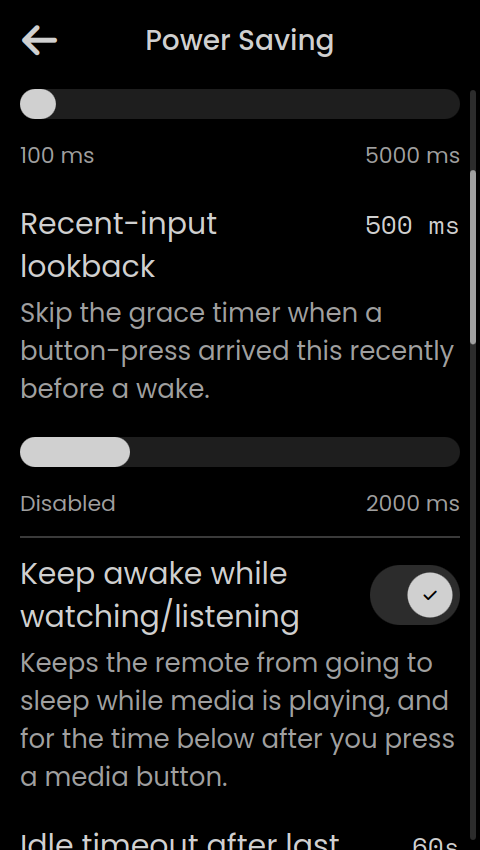 | 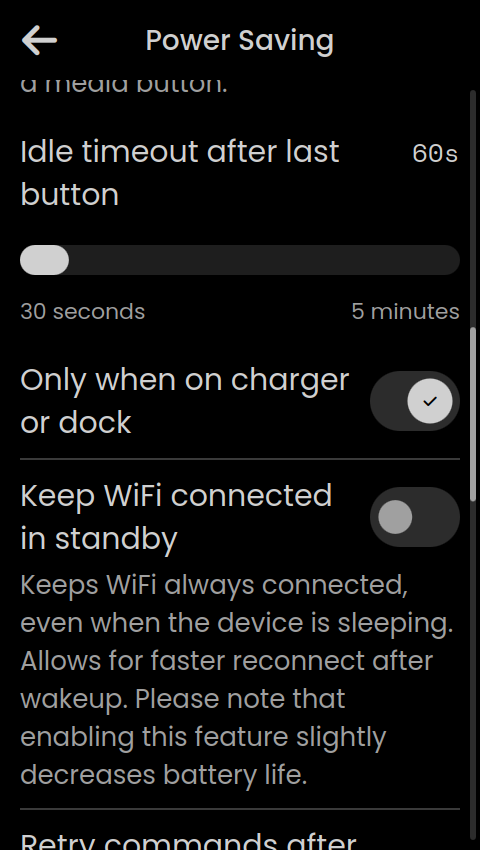 |

### User interface

On **Settings → User interface**:
- **Show volume overlay** (on by default): off hides Unfolded Circle's volume pop-up when you press a volume key; the volume still changes. An integration can also hide the pop-up for one of its media players.
- The volume pop-up opens only for media players that support volume up and down; stock UC opens it for every player. The key sends its command either way.
- **Show shuffle button**, **Show repeat button**, **Show media browser button** and **Show source picker button** (all on by default): off hides that icon on the control row of the media widget. The media browser and source picker icons also need a player that offers browsing or sources. With all four off, the empty row goes away. Holding the album art still opens the media browser.
- **Messages**, the last section of the page (v1.6.3):
  - **Show error pop-ups** (on by default, as on stock UC) covers a command that failed, the touch slider's "not available" warning and an integration that could not connect. Off: these show as a banner at the top of the screen that closes by itself and leaves the buttons working ("… is not responding", in red with the error code when the device refused the command), or as nothing with **Show a banner** off. There is no "Try again": press the button again. Other pop-ups, such as low battery, always show.
  - **Error banner duration** (1–30 s, default 5), shown while the banner is in use.
  - **Show offline banners** (on by default): off hides only the "… is unavailable" banner you get when you press a tile or an activity button for a device that is unavailable. It hides no other banner.
  - **Other banner duration** (1–30 s, default 4, Unfolded Circle's fixed time): how long every other banner stays.

| Show volume overlay | The media-button switches |
|:--:|:--:|
| 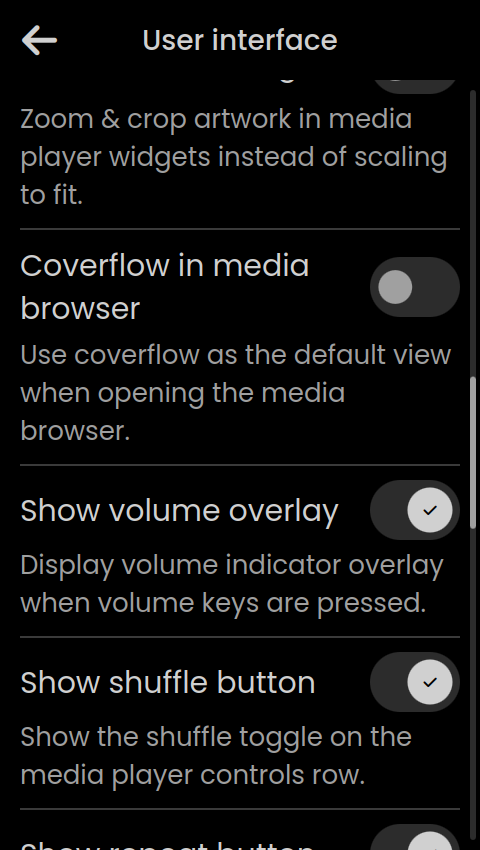 | 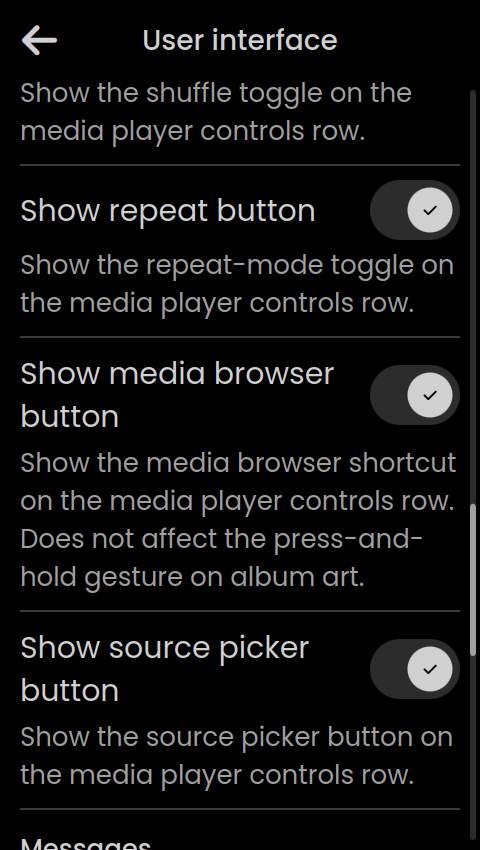 |

| Messages, with Show error pop-ups off | Show offline banners and Other banner duration | The error banner on the main screen |
|:--:|:--:|:--:|
| 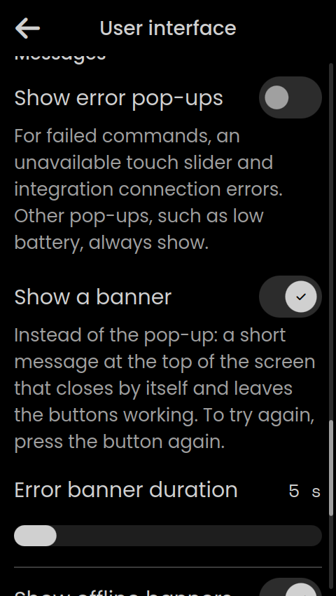 | 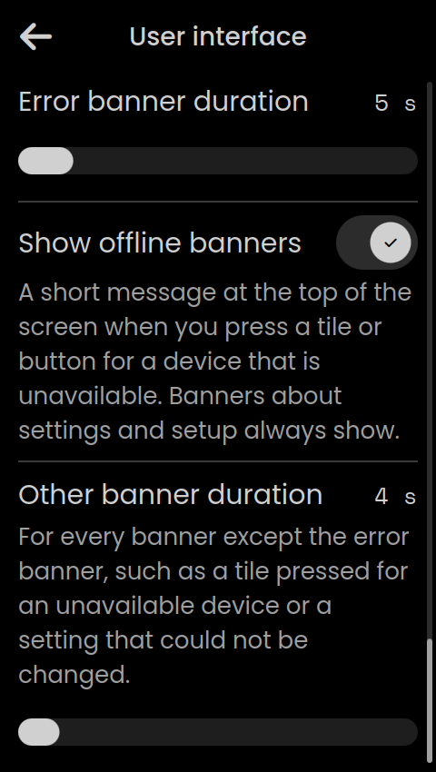 | 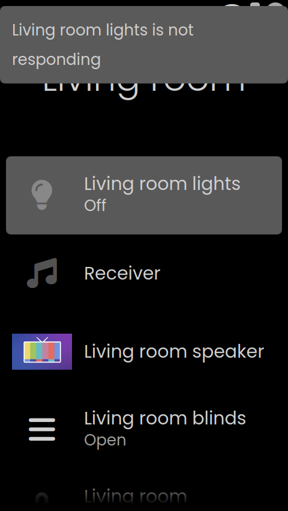 |

### Media browser and album art

- **Keys in the media browser:** MUTE toggles mute, STOP stops playback (when the player supports it), NEXT and PREV fast-forward and rewind when the player supports that and otherwise skip, and CHANNEL up and down page through the list (they repeat while held, and do nothing while the keyboard is open).
- **Loading:** while a list loads, a spinner appears inside the browser after 0.5 s, instead of Unfolded Circle's full-screen loading screen, which blocks the buttons; BACK and HOME keep working. A browser opened without its player closes itself instead of getting stuck.
- **Album art:** when you play an item from the browser, its thumbnail shows on the player at once and stays until the integration reports the real artwork; an empty artwork address or a Kodi placeholder image doesn't replace it. "Play next" and "Add to queue" leave the current artwork alone. Only web (http, https) and embedded (base64) images are used.

### Languages

The fork's own texts (the Screensaver page and its entry in the Settings menu, the rows it adds to Power Saving, Sound & Haptic and User interface, the Reconnect and Diagnostics buttons, the WiFi diagnostics sheet, and the screensaver's battery text and its Speed and Density labels) are in English on every UI language; Unfolded Circle's own texts stay translated. Only the English text file is edited in this repository: the other languages come from Unfolded Circle's translation service, which doesn't have the fork's texts.

---

## Install

> ### ⚠ Read this before installing on a UC3
>
> **Tested only on the maintainer's UC Remote 3, currently on firmware 2.12.1** (earlier releases soak-tested across 2.9.1 → 2.12.0). **v1.6.0 and later need firmware 2.12.0 or newer**: it is Unfolded Circle's 2.12.0 UI with our mods, and the release names that minimum, so the remote refuses the install on older firmware. **Check your firmware first:** a refused attempt also switches off the custom UI you had, and switching it back on is refused too (seen on firmware 2.12.0 with a test build). Installing v1.5.5 again, which sets no minimum that the remote checks, should bring it back (not tested). Other firmware versions and hardware revisions are **not** validated. Unfolded Circle's build and install steps also cover the Remote Two, and the code keeps its Remote Two support, but only a Remote 3 is tested here. If the custom UI fails to start on your device, the stock Qt UI is always available as a fallback — run:
>
> ```bash
> curl -X PUT "http://${UC3_HOST}/api/system/install/ui?enable=false" \
>     -u "web-configurator:${UC3_PIN}"
> ```
>
> The call is part of Unfolded Circle's documented Core API ("Enable or disable a custom component"): it switches the remote back to its stock UI and leaves the custom UI installed but switched off. The remote also switches back to the stock UI by itself when the custom UI fails to start a few times. **Save it before you install.** The install needs `?void_warranty=yes`: Unfolded Circle doesn't support a remote running a custom UI, and the remote records that confirmation permanently, so going back to the stock UI doesn't undo it. For extra safety, run [`scripts/deploy-canary.sh`](scripts/deploy-canary.sh) — it auto-reverts on health-check failure.

See **[SCREENSAVER-README.md](SCREENSAVER-README.md)** for the full install flow including device setup, PIN, and revert procedure.

Quick version for anyone who's already set up. v1.6.0 and later need firmware 2.12.0 or newer; on older firmware use v1.5.5
(same commands with `v1.5.5`).

```bash
# 1. Download the release tarball, its signature and the checksums
curl -L -O https://github.com/mmadalone/Madalones-Defolded-Circle-3/releases/download/v1.6.3/remote-ui-v1.6.3-UCR3-static.tar.gz
curl -L -O https://github.com/mmadalone/Madalones-Defolded-Circle-3/releases/download/v1.6.3/remote-ui-v1.6.3-UCR3-static.tar.gz.asc
curl -L -O https://github.com/mmadalone/Madalones-Defolded-Circle-3/releases/download/v1.6.3/remote-ui.hash

# 2. Verify integrity (SHA256 + GPG signature, see docs/RELEASE_SIGNING.md)
./scripts/verify-release.sh remote-ui-v1.6.3-UCR3-static.tar.gz remote-ui.hash remote-ui-v1.6.3-UCR3-static.tar.gz.asc

# 3. Install on your device (replace with your UC3 host and web-configurator PIN)
curl --location "http://${UC3_HOST}/api/system/install/ui?void_warranty=yes" \
    --form "file=@remote-ui-v1.6.3-UCR3-static.tar.gz" \
    -u "web-configurator:${UC3_PIN}"
```

The device reboots the UI process (~10 s). If anything breaks, revert to stock:

```bash
curl -X PUT "http://${UC3_HOST}/api/system/install/ui?enable=false" \
    -u "web-configurator:${UC3_PIN}"
```

**⚠ Warranty.** Unfolded Circle's install guide says that faults caused by a modified build aren't covered by the warranty, and that your statutory rights on the hardware are unaffected ([`docs/cross-compile.md`](docs/cross-compile.md)). The custom install endpoint requires the `?void_warranty=yes` query string, and the remote records that confirmation permanently: reverting to the stock UI doesn't undo it. Unfolded Circle doesn't support a remote running a custom UI.

For safer rehearsals, the repo ships a mock UC3 HTTP endpoint at [`scripts/mock-uc3-api.py`](scripts/mock-uc3-api.py) so you can exercise [`scripts/deploy-canary.sh`](scripts/deploy-canary.sh) locally before pointing it at a real device.

---

## Build from source

Requirements:
- Docker (for the ARM64 cross-compile and the desktop simulator, both in UC's static Qt toolchain images)
- Qt 5.15 on the host only for the test suites or a dynamic desktop build (optional)

```bash
# Clone
git clone https://github.com/mmadalone/Madalones-Defolded-Circle-3.git
cd Madalones-Defolded-Circle-3
git submodule update --init --recursive

# Cross-compile for UC3 (ARM64) with UC's Qt 5.15.19 toolchain: the image is pinned by digest, the version is a qmake argument
docker run --rm --user=$(id -u):$(id -g) \
    -v "$(pwd)":/sources \
    unfoldedcircle/r2-toolchain-qt-5.15.19-static@sha256:7d8fbf28308bd1c5628921fd79e10fe4cde17bbbea5efd0ec64606782feb271f \
    remote-ui.pro "CONFIG+=static CONFIG+=release UC_BUILD_VERSION=vX.Y.Z"

# Output: binaries/linux-arm64/release/remote-ui
```

Desktop simulator (no Qt installation needed): `make linux-x64`, then run it with `UC_MODEL=DEV` against UC's
[core simulator](https://github.com/unfoldedcircle/core-simulator).

See [`BUILD.md`](BUILD.md) for the full dev flow including the Windows / Git-Bash commands, `.env.local` setup for deploy
credentials, the test suites, the Docker VNC screensaver preview (`test/matrixrain_preview/`), and the on-device `logdy`
log viewer.

---

## Architecture

| Layer | Where | What |
|---|---|---|
| **C++ renderers** (`src/ui/`) | `matrixrain.cpp` (QQuickItem + QSGGeometryNode + texture atlas, orchestrator) + `src/ui/matrixrain/` 6 helper classes (LayerPipeline and its LayerOcclusion, AtlasBuilder, SingleLayerRenderer, InputHandler, BindingHelper — see `SCREENSAVER-IMPLEMENTATION.md`), `rainsimulation.cpp` (simulation logic), `glyphatlas.cpp` (GPU glyph atlas) | GPU pipeline, simulation tick, per-frame vertex emission on the Qt scene-graph render thread |
| **Config bridge** (`src/ui/`) | `screensaverconfig.{h,cpp}` + `screensaverconfig_macros.h` + `screensaverClosePolicy.h` | 132 QSettings-backed properties (all themes and overlays): 126 made by the `SCRN_BOOL/INT/STRING` macros and 6 written out (the five Matrix appearance values and "Close on wake", one property stored in two keys), plus 6 read-only derived values; the "Close on wake" rule is in `screensaverClosePolicy.h`. The values survive the popup being destroyed every time the screensaver closes |
| **QML themes** (`src/qml/components/themes/`) | `MatrixTheme.qml`, `StarfieldTheme.qml`, `MinimalTheme.qml`, `AnalogTheme.qml`, `TvStaticTheme.qml` | Thin QML wrappers implementing a common theme-native screen-off protocol (see `BaseTheme.qml` for the contract) |
| **Settings UI** (`src/qml/settings/settings/chargingscreen/`) | 13 sections on UC's design system (`Components.SettingRow`, shared `Components.ChipPicker`) | Theme picker + per-theme settings, every control reachable with the d-pad |
| **CI** (`.github/workflows/`) | `build.yml` (cross-compile + release + GPG signing), `test.yml` (our C++, QML and integration suites plus upstream's unit tests, and two quick text checks of upstream files we change: the `setPowerMode` field name and the touch slider's screensaver guards), `tidy.yml` (clang-tidy baseline), `code_guidelines.yml` (cpplint, design check, icon font), `docs-links.yml` (Markdown links) | Code changes are built on every branch but i18n, and tested and lint-checked on `main` and in pull requests (each workflow has its own branch and path filters); tagged releases are signed |

See [`STYLE_GUIDE.md`](STYLE_GUIDE.md) for the full architectural conventions and [`docs/CUSTOM_FILES.md`](docs/CUSTOM_FILES.md) for the custom-vs-upstream file manifest.

---

## Release verification

All tagged releases (`v1.2.2+`) ship with a SHA256 hash file; current releases also ship detached `.asc` GPG signatures.

```bash
# Import the project release key (one-time)
gpg --import docs/release-pubkey.asc

# Verify a download
./scripts/verify-release.sh \
    remote-ui-v1.6.3-UCR3-static.tar.gz \
    remote-ui.hash \
    remote-ui-v1.6.3-UCR3-static.tar.gz.asc
```

Key details + rotation procedure: [`docs/RELEASE_SIGNING.md`](docs/RELEASE_SIGNING.md).

---

## Upstream relationship

This is a **fork** of [`unfoldedcircle/remote-ui`](https://github.com/unfoldedcircle/remote-ui), tracked via the `upstream` git remote. All custom work lives on `main`; upstream releases are merged manually per the playbook in [`docs/UPSTREAM_MERGE.md`](docs/UPSTREAM_MERGE.md). Current fork base: **`v0.84.0`**, the UI of firmware 2.12.0, merged in v1.6.0 (upstream had rewritten its history, so the merge needed a one-off graft; the playbook has the steps).

Because upstream's code is merged with its history, upstream's developers and bots (and the co-authoring AI, see below) show up in this repository's contributors graph next to the maintainer.

If you're looking for the source of the stock UI, go to the upstream repo. This fork adds the screensaver and the other changes listed under [Features](#features).

---

## How this was built

> *"Every line of code in this project was generated by **Claude** (Anthropic). I'm the architect who can't hold a hammer — I know what I want the building to look like, I can read blueprints, I can tell you when something's wrong, but I'm not the one pouring the concrete."*

This fork was **vibecoded** — designed, implemented, audited, and iterated entirely through conversation with [Claude Code](https://claude.ai/claude-code) (Anthropic's CLI agent). Every C++ renderer, GPU shader, QML component, settings sub-page, test file, CI workflow, and line of documentation — including this README — was produced through the same iterative loop:

1. **Describe intent** in natural language ("add a hidden message system that writes single chars into rain streams").
2. **Generate** the implementation (usually spanning C++ renderer + config bridge + QML wrapper + settings UI + qrc registration + unit tests, in a single coherent change).
3. **Rebuild** via the Docker ARM64 toolchain (`unfoldedcircle/r2-toolchain-qt-5.15.19-static`; Qt 5.15.8 up to v1.6.0) and/or the Docker VNC screensaver preview (`test/matrixrain_preview/`) for visual verification against the actual Qt scene graph.
4. **Deploy** to a real UC Remote 3 via the stock install API (`/api/system/install/ui?void_warranty=yes`), verify the feature docked and on battery, verify no regressions in adjacent behavior (dock/undock cycles, screen-off animations, wake paths, thermal).
5. **Refine** until everything holds, then commit with a conventional-commits message that explains the *why*, not just the *what*.

No line was copy-pasted from a tutorial, Stack Overflow answer, or LLM playground. Every fix was validated on actual hardware before shipping.

### Human-reviewed documentation

Every user-facing document in this repo — this README, [`SCREENSAVER-README.md`](SCREENSAVER-README.md), [`BUILD.md`](BUILD.md), install instructions, release notes, upstream merge playbook, release signing procedure — is **human-reviewed and corrected** before it ships. The AI writes the first draft; the maintainer proofs every claim, verifies every screenshot reference, tests every curl command against the actual device, and rewrites anything that reads as hallucinated, out-of-date, or vague. If you spot a factual error in the docs, it's a bug — please open an issue.

### Thorough audits

The codebase has been through a full industry-standard audit ("brutally honest, no glazing") that graded it at B−/C+ on first review and then took it to a true **A grade** via seven sequenced batches — documented end-to-end in the plan file and in this repo:

- **Batch 0** — 4 user-reported screensaver bug fixes (close-on-wake-undock, Matrix/Starfield wake-black, idle-screensaver-off, display-off gap) + a thermal regression fix (sim pause during `displayOff`) + a DPAD direction respawn fix. Shipped as **v1.2.2**.
- **Batch A** — version sync CI gate, credentials scrubbed from every tracked doc, 60 MB of build-artifact git debt purged, `CRITICAL` landmine comments on the Qt 5.15 qmlcachegen binding race in AnalogTheme.
- **Batch B** — strict warning flags enabled project-wide (`-Wall -Wextra -Werror=format -Wold-style-cast -Wfloat-equal -Woverloaded-virtual -Wshadow`) with the full cascade fixed in every custom `src/ui/*` file. No pragma suppressions — root causes only.
- **Batch C** — `.githooks/pre-commit` running `cpplint.sh` + `clang-format --dry-run -Werror`; `lupdate` i18n baseline populated; [`docs/UPSTREAM_MERGE.md`](docs/UPSTREAM_MERGE.md) playbook; CHANGELOG sync gate in CI on tagged commits.
- **Batch D** — `clang-tidy` in CI via `.github/workflows/tidy.yml` with a starter ruleset (`modernize-*`, `bugprone-*`, `cert-*`, `performance-*`), tolerant baseline mode, per-file `NOLINT` comments with reasons for any intentional upstream-compat cases.
- **Batch E** — dead `CFG_*` macro family deleted, `SCRN_*` documented as canonical in [`STYLE_GUIDE.md`](STYLE_GUIDE.md) §6.6; four new QML theme lifecycle tests covering Starfield, Minimal, Analog, and TV Static beyond the existing Matrix suite.
- **Batch F** — GPG release signing pipeline ([`docs/RELEASE_SIGNING.md`](docs/RELEASE_SIGNING.md), [`scripts/verify-release.sh`](scripts/verify-release.sh)); canary deploy with auto-revert on health-check failure ([`scripts/deploy-canary.sh`](scripts/deploy-canary.sh)) and a local mock UC3 endpoint ([`scripts/mock-uc3-api.py`](scripts/mock-uc3-api.py)) so the canary path can be rehearsed without a spare device.
- **Batch G** — upstream merge rehearsal under the new playbook (result: fork is a strict superset, zero conflicts); [`docs/A11Y_AUDIT.md`](docs/A11Y_AUDIT.md) walkthrough; real translations populated for two non-English locales (today no other language has the fork's own texts, see [Languages](#languages)); CycloneDX [`sbom.cdx.json`](sbom.cdx.json) regenerated in CI.

### Testing discipline

- **Over 800 automated test cases** (2026-11-12): 260 C++ unit tests for the Matrix renderer (`test/matrixrain/`), 161 for keep awake, the phantom-wake suppressor, power, the entity controller (with the Messages settings' banners) and the screen-off sync (`test/hardware/`), 33 for the Close on wake rule (`test/screensaver/`: every choice, the two stored keys, reading a v1.6.3 `config.ini`, a lift), 343 QML tests (`test/qml/`: the Starfield, Minimal, Analog and TV Static themes, settings bindings, visibility, d-pad navigation, the chip picker, the Close on wake row, the touch slider while the screensaver shows, WiFi diagnostics, the Wipe speed rows, the Messages section and the banners) and 41 integration tests (`test/integration/`: the Matrix rain item's life cycle, config propagation, a chaos stress test and the OK-button state machine), plus upstream's own unit-test suite (30 programs). CI's CMake job builds and runs that suite together with our Matrix renderer and Close on wake tests: 32 programs.
- **Five CI workflows**, each with its own triggers: `build.yml` (ARM64 cross-compile + release + GPG signing; pushes that touch code to any branch but i18n, pull requests to `main`, `v*` tags), `test.yml` (all the suites above; pushes that touch code or tests to `main`, pull requests to `main`), `tidy.yml` (clang-tidy baseline; pushes that touch C++ under `src/ui/`, pull requests to `main`), `code_guidelines.yml` (cpplint, design check, icon font; pushes that touch code to `main`, pull requests that touch code), `docs-links.yml` (Markdown links; Markdown changes on `main` and in pull requests to `main`).
- **On-device verification of the Batch 0 fixes** (v1.2.2), including a 10+ minute sustained dock for the thermal fix (SCREENSAVER-IMPLEMENTATION.md, "Shipped as v1.2.2"); all of them were checked again on the remote in the 2026-05-20 audit ([`docs/A11Y_AUDIT.md`](docs/A11Y_AUDIT.md) §4).
- **Visual Docker VNC preview** — renders the actual `QSGGeometryNode` scene graph via Mesa software OpenGL in a disposable container, for when the macOS native build can't exercise the code path (Qt 5.15 OpenGL 2.1 limitation).
- **Settings round-trip verified** — every screensaver setting persists across the full Popup destroy/recreate cycle that happens every time the screensaver closes and opens again, because `ScreensaverConfig` is a QSettings-backed C++ singleton and not a Popup property.

### Safety posture

Because the device is a piece of hardware that belongs to someone, every change is built with the revert path as the first-class backstop:

- **Stock UC firmware is never modified.** The custom install only runs a custom Qt `remote-ui` process in place of the stock one, which stays installed. Boot, the core, the integrations and the core API are untouched.
- **Revert is one curl command** (`/api/system/install/ui?enable=false`), part of Unfolded Circle's documented Core API. The install section of this README shows it before the install command, not after.
- **Canary deploy with auto-revert** is available via [`scripts/deploy-canary.sh`](scripts/deploy-canary.sh) for anyone who wants the extra safety net on first install.
- **Upstream divergence logged** in [`docs/UPSTREAM_MERGE.md`](docs/UPSTREAM_MERGE.md) before every release — no silent drift from the upstream baseline.
- **Warranty state is explicit** — the `?void_warranty=yes` install flag is called out before the install command. The remote records it permanently; the revert does not undo it.

---

## With love and thanks

To **Jessica** — for your patience with my obsession(s) — the plural is deliberate — for tolerating the marathonian sessions that come with them. Not once did you throw the remote across the room. None of this exists without you making space for it, and for being the one who makes the coming-up-for-air part worthwhile. None of this exists without you. ❤

---

## Contributing

[`CONTRIBUTING.md`](CONTRIBUTING.md) covers the workflow, code style (`cpplint.sh` + `.clang-format`), the local pre-commit hook (`.githooks/pre-commit`), and the PR process.

Custom modifications should follow the mod pattern documented in [`STYLE_GUIDE.md`](STYLE_GUIDE.md) §1 (anatomy: C++ renderer + `SCRN_*` config bridge + QML wrapper + settings sub-page + qrc registration).

---

## Version history

[`CHANGELOG.md`](CHANGELOG.md) has the full notes of every release: the fork's releases first, then upstream Unfolded Circle's. The entries below are short summaries.

**Unreleased** — **Close on wake: Never, Undocked or Always** ([GitHub issue #3](https://github.com/mmadalone/Madalones-Defolded-Circle-3/issues/3)), and **the touch slider under the screensaver**. The "Close on wake" switch in Settings → Screensaver becomes three choices. **Never** (the default, the switch off): the screensaver stays until you close it, also when you lift the remote. **Undocked** (new): a wake on the dock, such as a touch or a bump of the nightstand, leaves it showing; lifting the remote closes it a few seconds later, and a wake away from the dock closes it. **Always** (the switch on): every wake closes it, on the dock too, and so does leaving the dock. Your setting carries over, and v1.6.3 reads Undocked as the switch on. The remote notices a lift only at its battery check, about every 5 seconds: on the maintainer's Remote 3 on a Qi pad the lift was reported 2.3–4.6 s after it woke the remote (13 recorded lifts), so with Undocked the screensaver stays in the hand that long, and a button pressed in that time goes to the screensaver, so your button mappings don't run (worked out from the code, not yet tried on a remote). When a Qi pad stops charging (seen at 80 % and when full), the remote reports the charger gone, so Undocked, like Always, closes the screensaver on the pad. Also: with "Chime after screensaver" on, putting the remote back on the dock while the screensaver is still showing plays no chime (before, the chime played at a later, unrelated opening of the screensaver), and the help texts of "Run after dismissal while docked" and "Touch directions" now match what the remote does (the fourth quick tap in the centre closes the screensaver, not the third). The custom UI's log (`/api/system/logs?s=custom-ui&p=7`) shows the choice at start-up and whenever it changes, and, with Undocked or Always, whether each wake or charger loss closes or keeps the screensaver. The touch slider: a slide already under way when the screensaver appears now ends there, as if you had taken your finger off. Before, it kept putting the device back to the slider's value (on a seek slider, playback jumped back every second) until the slider was next used outside the screensaver or you left that screen. A lift with no slide under way no longer sends the slider's last value, or 0. Close on wake was checked in the desktop simulator and the touch slider fix in the QML tests; neither has been tried on a remote yet. See [`CHANGELOG.md`](CHANGELOG.md) for the details.

**v1.6.3** (2026-11-07) — **Messages settings: error pop-ups can make way for a banner.** A new Messages section at the bottom of Settings → User interface. With "Show error pop-ups" off, a failed command, the touch slider's "not available" warning or an integration that could not connect shows a short banner at the top of the screen that closes by itself and leaves the buttons working, instead of a pop-up you have to close first (or nothing at all, with "Show a banner" off too); to try again, press the button again. The error banner and the other banners each get a duration slider (1–30 s; 5 s and 4 s by default), and "Show offline banners" can hide the "… is unavailable" banner of a tile or button pressed for an unavailable device. With the default settings the remote behaves as before. Needs firmware 2.12.0 or newer, like v1.6.0; checked on 2.12.1. See [`CHANGELOG.md`](CHANGELOG.md) for the details.

**v1.6.2** (2026-11-03) — **Screensaver fixes and two new sliders.** Matrix rain reaches every column and row, and with Rain layers the nearer rain hides the rain behind it, so columns no longer squeeze into solid strips. The Screen wipe crosses the whole screen, and Tap effects and Chaos events each get a Wipe speed slider. Screen-off animations play to the end and the screen goes off right after them, with an Animation length slider for the drawn styles. A d-pad direction no longer turns into Auto-rotate after a wake. Needs firmware 2.12.0 or newer, like v1.6.0; checked on 2.12.0 and 2.12.1. See [`CHANGELOG.md`](CHANGELOG.md) for the details.

**v1.6.1** (2026-11-01) — **Built with Unfolded Circle's Qt 5.15.19 toolchain**, the one UC builds its own UI with (was Qt 5.15.8). Same features as v1.6.0, and the remote needs exactly the same system libraries as before. The keep-awake, phantom-wake and sound diagnostics are logged at info instead of warning (read them with `/api/system/logs?s=custom-ui&p=7`); failures stay warnings. Security problems can be reported privately through GitHub. Needs firmware 2.12.0 or newer, like v1.6.0. See [`CHANGELOG.md`](CHANGELOG.md) for the details.

**v1.6.0** (2026-11-01) — **On Unfolded Circle's current UI (v0.84.0, the UI of firmware 2.12.0).** The d-pad works on every screen, holding HOME opens the page menu, and no text is smaller than 22 px. The Screensaver settings, the dock-chime and screen-off pickers and WiFi Diagnostics follow UC's design system; every screensaver setting can be reached with the d-pad, also after the page is opened again. The screensaver keeps the buttons when it opens before the main screen at start-up. The album-art preview from the media browser is back on UC's new artwork code. Keep awake follows only the players on your pages. The Wake-replay HUD and our battery chip are replaced by UC's own. See [`CHANGELOG.md`](CHANGELOG.md) for the details.

**v1.5.5** (2026-10-31) — **Keep awake and the phantom-wake suppressor recognise button presses.** Both compared bare command names while commands arrive as `media_player.play_pause`, so nothing matched: the idle timeout after the last button never started, and the press that woke the remote was taken for a phantom wake, which sent it back to sleep (the backlight blinked for about 20 s after a wake-up).

**v1.5.4** (2026-10-31) — **The GitHub download now includes the sounds.** Same code as v1.5.3. Since v1.4.41 the GitHub release bundle was missing the button sounds and the 12 dock chimes, so a remote installed from GitHub had no UI sounds and no dock chime; the bundle now contains every file of `config/`. `scripts/verify-release.sh` no longer reports a valid signature when gpg could not check it.

**v1.5.3** (2026-10-31) — **Five fixes backported from upstream `v0.83.0` / `v0.84.0` (the UI of UC firmware 2.12.0).** The status bar's hidden "connecting" animation no longer runs all the time, so the screen stops redrawing while nothing changes (less CPU and battery). The UI window is hidden whenever the display is off, including when the phantom-wake suppressor sends the remote back to sleep. A stop request right after start-up is no longer lost (it could reboot the remote into the stock UI). A screen the UI doesn't have, such as 2.12.0's new number entities, no longer blocks every other screen. New on-screen keyboard layouts for nine languages, Spanish included, following the remote's language. Verified on firmware 2.12.0.

**v1.5.2** (2026-06-07) — **Upstream `v0.73.5` merge (Option-B), bundled in UC firmware 2.9.5.** Upstream refactored standby-detection-for-command-retry in `EntityController::onPowerModeChanged` (`m_previousPowerMode` enum → `m_wasSuspended` bool + a new `!m_resumeWindow` debounce). Resolved by adopting upstream's cleaner structure while broadening the flag-set to `SUSPEND || LOW_POWER`, so the v1.4.19 wake-replay window keeps engaging on UCR3 (which sleeps via LOW_POWER and never enters SUSPEND — upstream's `SUSPEND`-only form would silently disable it). Sole intentional divergence, kept on upstream's variable name per rule #10. Wake-replay HUD confirmed on-device on firmware 2.9.5; all CI green.

**v1.4.36** (2026-05-02) — **B1 matrixrain decomposition.** Largest single-file refactor in the project's history: `matrixrain.cpp` shrunk 1445 → 746 LOC (-48 %) across three architectural phases, each independently CI-green and visually verified on UCR3. New helpers in `src/ui/matrixrain/`: `SingleLayerRenderer` (Phase A — stateless render path, mirrors LayerPipeline), `InputHandler` (Phase B — QObject-with-timers, owns enter-button state machine + 2 internal timers, mirrors ActivitySessionKeeper / PhantomWakeSuppressor), `BindingHelper` (Phase C — all-static, 8 ScreensaverConfig binding helpers, mirrors AtlasBuilder). QML contract preserved verbatim. Also: C1 `ScreensaverConfig` Battery-deferred-connect cleanup (drops `QTimer::singleShot(500, ...)` retry hack via `main.cpp` construction reorder), STYLE_GUIDE §1.4 AP-UC-13 extension covering Repeater `model:` gating, settings description text consistency sweep (3× `colors.medium` → `colors.light`).

**v1.4.21** (2026-04-30) — Reconnect HUD overhaul + WiFi-everywhere toggle. `ReconnectingHUD` bumped 60 → 120 px, font 24 → 32, spinner 36 → 56, `colors.dark` → `colors.medium`, added 3-second opacity pulse so the post-wake banner is hard to miss. New `WifiStatusChip.qml` (~50 lines) + `Settings → UI → Show WiFi indicator everywhere` (default on) puts the always-visible signal-strength chip on every entity / activity detail page, just left of the battery chip — mirrors `StatusBar.qml`'s WiFi indicator (Mod 4 W3). When chip is on, the existing weak-signal warning icon hides because the chip carries the disconnected-state info. CI workflow `build.yml:151` patched to stage the install-bundle layout (`release.json + bin/remote-ui + config/`) before tarring — fixes a long-standing release bug where the published tarball was rejected by the firmware install endpoint with "Missing file: remote-ui".

**v1.4.20** (2026-04-30) — **Mod 6: Phantom-Wake Suppressor.** Inverse-symmetric companion to Mod 5. New `uc::hw::PhantomWakeSuppressor` singleton at `src/hardware/phantomWakeSuppressor.{h,cpp}` (~75 / ~110 lines). On `Power::powerModeChanged(from, to)`: if `from == LOW_POWER || SUSPEND` and `to == NORMAL`, arms a single-shot grace timer (default 500 ms, range 100–2000). If user input fires during grace (`InputController::keyPressed` / `touchDetected`, `TouchSlider::touchPressed`, `Battery::powerSupplyChanged`), timer cancels — wake-press path unaffected (~242 ms wake-to-functional measured on hardware). If grace expires without input, calls `core::Api::setPowerMode(LOW_POWER)` to force the device back to standby. Eliminates the ~9 %/hr off-dock battery drain caused by WoWLAN-induced phantom wakes (~5 min of NORMAL/IDLE per phantom wake → ≤500 ms per phantom wake). Default off. Bundled with this release: re-enabled the dormant WS keepalive at `core/core.cpp:26-30` (was commented out by upstream, never wired) — 60 s `m_webSocket.ping()` keeps the localhost UI ↔ core daemon connection healthy across kernel-suspend; eliminates the multi-second WS-reconnect tail on first wake-press. `Wifi` callback emit-guards (`isConnectedChanged` no longer fires every 30 s poll regardless of state change). Dead `oldNetwork` swap in `Wifi` ctor removed.

**v1.4.19** (2026-04-29) — Wake-replay HUD + LOW_POWER wake-trigger fix. New `ReconnectingHUD` overlay (`src/qml/components/overlays/ReconnectingHUD.qml`, removed in v1.6.0, ~75 lines QML) shows a top-banner "Reconnecting…" slide-down whenever `EntityController.resumeWindow` is true. Bigger fix snuck in alongside: `entityController.cpp:757`'s wake trigger expanded from SUSPEND-only to `LOW_POWER || SUSPEND` — UC3's typical 5-min standby uses LOW_POWER (REST probe of `/api/system/power` confirmed; never observed SUSPEND in 6 v1.4.x releases of probing), so the upstream `m_pendingCommands` retry mechanism had been a no-op for daily wakes. With this fix, the existing 500 ms retry loop actually engages. HUD is purely a visual layer over plumbing that's been there all along.

**v1.4.18** (2026-04-29) — CI fix: bump `remote-ui.pro:75` `VERSION` from 1.4.11 → 1.4.18. Six releases (v1.4.12-v1.4.17) silently failed the `.github/workflows/build.yml:44-55` consistency check between `remote-ui.pro` and `release.json`. No runtime impact; firmware-side displayed version comes from `GIT_VERSION` (`git describe --tags`). CI artifact build was the only consumer of the bumped line.

**v1.4.17** (2026-04-29) — WiFi Diagnostics popup (W13). New "Diagnostics" button in the WifiInfo popup action stack opens a focused diagnostic surface with: RSSI sparkline (Canvas, last 60 samples, dashed reference lines at SignalStrength tier thresholds -60/-76/-84 dBm), live RSSI + link speed, drops since boot, current session uptime (HH:MM:SS, 1 Hz tick), time since last drop, Reset counters button (with confirmation dialog). New custom QML file `WifiDiagnostics.qml` (~280 lines). C++ surface: 4 new Q_PROPERTYs on Wifi singleton (`rssiHistory` QVariantList, `disconnectCount`, `currentSessionDurationSec`, `secondsSinceLastDisconnect`) + ring buffer `m_rssiHistory` (capped at 60) + `Q_INVOKABLE resetDiagnosticCounters()`. 5 s fast poll while popup open, 30 s background W6 poll otherwise; both push to the same buffer.

**v1.4.16** (2026-04-29) — Post-v1.4.15 polish round. Power "Keep awake" slider thinned (drops low/high labels — value already in title; `height: 60` matches existing `idleTimeoutSlider`). Screensaver docked-rearm gating fix: `_shouldOpenOnIdle()` was incorrectly required, now fires whenever docked + non-DEV regardless of "Idle screensaver" toggle. Slider label clip fix ("Re-run after dismissal while docked" → "Run after dismissal while docked"). Min lowered 30 s → 5 s. WifiInfo action buttons folded back into Flickable scroll content (per user feedback — v1.4.14's pinned-bottom design felt mid-screen).

**v1.4.15** (2026-04-29) — UI polish triple. (1) Power slider preferredHeight 60 → 100 → 140 to fit pressed-state `lowValueText`/`highValueText` overflow (later rolled back in v1.4.16 by dropping the labels). (2) WifiInfo back-arrow at top-left + drop redundant bottom Close button. (3) Screensaver docked-rearm: pre-existing UC bug — `main.qml:648–655` only restarted `idleScreensaverTimer` when undocked; new `dockedRearmTimer` (driven by `ScreensaverConfig.reopenWhileDockedSec` Q_PROPERTY, range 5–120 s, default 60) re-activates `chargingScreenLoader` after configurable delay following docked tap-dismiss. Cancels on undock and on `Power.Normal` wake-re-open. New slider in Settings → Screensaver → General Behavior, always visible.

**v1.4.14** (2026-04-28) — Mod 5 Active Session Keeper. Wires the previously-orphan `RequestTypes::set_power_mode` (was in `enums.h:96` with zero callers — same orphan-surface pattern as v1.4.12's `REASSOCIATE`). Probe-confirmed `PUT /api/system/power?power_mode=NORMAL` resets firmware's `standby_timeout_sec` to its configured max on every LOW_POWER/IDLE → NORMAL transition. New `uc::hw::ActivitySessionKeeper` singleton holds a 270 s repeating ping timer + a single-shot idle-window timer; state machine collapses to one boolean. Triggered by `EntityController::mediaPlayerStateChanged` (Playing) and `EntityController::entityCommandIssued` (curated allowlist). Three Settings → Power rows (default off, default 60 s idle, AC-required default true).

**v1.4.13** (2026-04-28) — Onboarding WiFi scoped failure cleanup (W9). Replaces nuclear `Wifi.deleteAllNetworks()` on join failure with new `Q_INVOKABLE Wifi::deletePendingJoinNetwork()`; tracks `m_pendingJoinSsid` set in `Wifi::connect`, cleared on `WifiEvent::CONNECTED`. Pre-checks `m_knownNetworkList.contains()` to silence "network not found" on race against `addNetwork`'s async response.

**v1.4.12** (2026-04-28) — Mod 4 WiFi UX bundle (W1–W6, W10). Wires REASSOCIATE for explicit Reconnect button, surfaces 7 firmware-side Q_PROPERTY diagnostics on the WifiInfo popup (RSSI dBm, link speed, BSSID, channel computed from freq, throughput-when-nonzero), always-visible signal-strength bar in StatusBar, WoWLAN toggle now reachable on UCR3 (was env-var-gated upstream — closes 2026-04-24 HA-entity-prune memory), 30 s periodic `getWifiStatus` poll while connected + display awake, `displayOff` gate on scan timers in both settings + onboarding.

**v1.4.11** (2026-04-27) — Audit-driven hardening release. (1) `MatrixRainItem` 7 timer-start callsites consolidated behind `displayOff`-gating helpers (AP-UC-08 violation closed); (2) `EntityController::clearEntitiesDeferred()` plugs slow per-reconnect leak via `QTimer::singleShot(100, deleteLater)`; (3) toolchain image pinned by digest in `BUILD.md`.

**v1.4.10** (2026-04-27) — `entity_change` apply gap fix. `entityAdded` was orphan upstream — emitted at `core.cpp:2142` but never connected in `EntityController`. Fixed wiring + 2 backstops. Latent upstream bug surfacing only after integration uninstall→reinstall cycle (rare for end-users, common for integration devs).

**v1.4.9** (2026-04-24) — MediaBrowser → player-widget thumbnail preview handoff (new `Q_INVOKABLE MediaPlayer::setPreviewImage(QString)`, threaded through all 10 `requestPlayMedia` call sites in `MediaBrowser.qml` + the `buildPlayMenu` helper; preview-preserve guard in `updateAttribute(Media_image_url)` swallows empty / 12 canonical Kodi-default-placeholder URLs post-preview; flag lifetime threaded via `reply->setProperty("isPreview", ...)` so real-URL fetch failures preserve the preview instead of blanking). Scheme filter on `setPreviewImage` rejects unfetchable `icon://` / `image://` / non-image data URIs at entry — pre-filter, unscraped items burned 3 × 1 s retries on `icon://uc:video`; post-filter zero retry noise (confirmed in logdy). Empty controls-bar auto-collapse: `controlsContainerHeight` in `MediaComponent.qml:50` evaluates to 0 when all four v1.4.8 button Configs are false, so the 80 px RowLayout collapses cleanly instead of reserving an empty gap under the progress bar. Pure FW-side; zero ucapi contract change; companion integration-side art-resolution fix tracked separately.

**v1.4.8** (2026-04-24) — Touchbar sensitivity tuning (~3× less sensitive) + 4 global `Settings → UI` toggles to hide individual shuffle / repeat / media-browser / source-picker icons on the media player controls row. Motivation: integrations can't selectively strip individual `MediaPlayerFeatures` bits to hide just one icon; UC-side toggles solve at the display layer. AND-chained with entity feature checks — never unhides a button the entity chose not to expose.

**v1.4.7** (2026-04-24) — TouchSlider screensaver guard completeness. Physical slider touches during the screensaver were bleeding through to the active media_player entity (volume / seek / brightness / position commits on release) because the `screensaverActive` guard was only on `onTouchPressed` — `onTouchXChanged` and `onTouchReleased` ran ungated in all 4 TouchSlider variants. Fix: same guard added to both handlers across all 4 variants. 8 one-liners.

**v1.4.6** (2026-04-24) — Quiet boot hygiene pass. Boot-log warning count reduced ~177 → ~4 via targeted fixes: `QNetworkReply::OperationCanceledError` filter at both `mediaPlayer.cpp` log sites (eliminates 167× per-boot image-cancel flood), terminal `return ""` in `VoiceOverlay.qml:666` JS binding, missing `import TouchSlider 1.0` added to `main.qml` (also unmasked a silently-broken slider-to-idle-reset wiring), file-existence guard in `soundEffects.cpp::createEffects()` (eliminates 5× QSoundEffect decode warnings when env var is unset).

**v1.4.4** (2026-04-24) — MediaBrowser full hardware-button coverage (MUTE / STOP / NEXT / PREV / CHANNEL_UP / CHANNEL_DOWN as context-aware page-scroll) + 14-site volume split-guard refactor (separates command dispatch from OSD display) + new per-entity `hideVolumeOverlay` flag on MediaPlayer, ingested from ucapi `options["hide_volume_overlay"]`.

**v1.4.3** (2026-04-24) — MediaBrowser unescapable-loading-loop hotfix. `onOpened` null-guard + replace global `LoadingScreen` with inline `BusyIndicator` (no input-block) + 15 s watchdog timer. Prevents the 3-minute lockout the pre-v1.4.3 upstream had when a transiently-null `entityObj` binding race hit mid-open.

**v1.4.2** (2026-04-24) — `Config.showVolumeOverlay` global user-preference toggle (default on). Suppresses the volume OSD without disabling VOLUME_UP / VOLUME_DOWN commands. Single early-return guard in `VolumeOverlay.qml::start()` covers all 16 call sites.

**v1.4.1** (2026-04-24) — Volume OSD feature-check guards at 7 previously-unguarded call sites (`Page.qml`, `MediaBrowser.qml`, 5 deviceclass files). Upstream bug: `volume.start()` was firing unconditionally even when the entity had removed `Volume_up_down` from its feature set. Fix adds the same `hasFeature(...)` check `Activity.qml` already had. Upstream-contributable.

**v1.4.0** (2026-04-23) — Upstream `v0.72.0` merge (press-and-hold album art → media browse, smarter error handling, UC's independently-shipped "Show battery indicator everywhere"). Option B rebase: adopted upstream's public API, kept our superior chain-anchoring `RowLayout` for 6 status indicators in `BaseDetail.qml`. One-shot QSettings migration preserves v1.3.0 user state (`ui/batteryOnDetailPages` → `ui/batteryEveryWhere`).

**v1.3.0** (2026-04-23) — Mod 1 architectural cleanup (matrixrain.cpp 2055 → ~1430 lines via `LayerPipeline` + `AtlasBuilder` extraction, 8 dead `tap*()` wrappers deleted) + Mod 3 detail-page battery chip + atlas profiling overlay + dead-code sweep + Settings → Screensaver open-freeze fix (deferred Loaders) + hot-path render allocation removal.

**v1.2.2** (2026-04-13) — 5 screensaver bug fixes, thermal sim-pause, DPAD respawn fix, strict warning flags, clang-tidy CI, i18n baseline, macro cleanup, release signing + canary deploy scripts, upstream merge rehearsal, SBOM, a11y audit checklist.

**v1.2.1** — drop `displayOff` gate from matrix running binding (fixes wake-black race).
**v1.2.0** — runtime slider fix, tap master toggle.
**Earlier** — theme selector, GradientText, Analog theme, TV Static theme, screen-off animation system.

---

## Roadmap / backlog

State of the world at v1.6.0. Items here aren't TODOs in the imperative sense — they're "if I ever care, this is where I left it."

**Validation pending (no code, just observation):**
- **W6** 30 s periodic `getWifiStatus` poll visibility in Logdy.
- **W10** scan-timer halt on screen-off in Logdy.
- **WoWLAN day-long battery-impact** observation (pruning the HA entities pushed to the remote was an effective mitigation in April 2026).

**Backlog (low-priority, deferrable):**
- **W7** — WpaState progression UI in connect flow. Helps debug stuck-handshake / wrong-password scenarios with "Authenticating…" / "4-way handshake" intermediate labels. Niche; rare event.
- **W8** — proper WPA3/EAP scan-result auth parsing. Since upstream 0.84 the current connection's security comes from its key management (WPA3/SAE included), but scan results still classify every secured network as `WPA2_PSK` (`src/system/wifi.cpp`). Visual-only; the lock icon is correct.
- **W11** — WPA3 / Enterprise option in the "Join other" wizard. Corporate-network scenario.
- **W14** — WiFi quick-toggle in notification drawer (phone-style control center). ~80 LOC.

**Skipped (covered or duplicative):**
- **W12** — per-network auto-connect toggle. Already covered by Enable/Disable in `WifiNetworkList.qml` known-networks list.

**Deferred concepts (no plan, no commitment):**
- ~~Per-integration "Reconnecting to {X}…" labels on the Wake-replay HUD~~ — dropped with the HUD in v1.6.0.
- `docs/CUSTOM_FILES.md` per-Mod sections rewrite. Currently v1.4.11 baseline; only the v1.4.12+ summary table is current. Skip until a contributor needs the per-Mod detail.
- Mod 6+. No specific candidate queued.

---

## License

**GPL-3.0-or-later** — see [`LICENSE`](LICENSE). Custom firmware modifications are under the same license as the upstream project. Third-party dependencies listed in [`sbom.cdx.json`](sbom.cdx.json) and [`licenses/remote-ui_licenses.md`](licenses/remote-ui_licenses.md).

---

## Not affiliated with Unfolded Circle

This is an independent community mod. Unfolded Circle does not endorse or support installs of this firmware. For the official product, see [unfoldedcircle.com](https://unfoldedcircle.com).
