# Custom Screensaver for Unfolded Circle Remote 3

A configurable screensaver for the UC Remote 3 with **five themes**: GPU-drawn Matrix rain, a Starfield warp, a Minimal digital clock, an Analog clock and TV Static, all set up in Settings → Screensaver. It opens when you put the remote on its dock, in place of Unfolded Circle's charging screen (an analog clock), and, if you turn on Idle screensaver, after a while without use off the dock. Matrix also reacts to the d-pad, the touch slider and touch gestures. On Starfield the touch slider changes the star density, and on TV Static the d-pad arrows and the volume and channel keys fire a channel flash. Minimal and Analog don't react to the d-pad, the touch slider or gestures. A shared **screen-off animation** (Settings → Power Saving) can play on the screensaver just before the display turns off, by default only while the remote is on its dock. Its default style, Theme, draws something only on TV Static and Analog, the two themes with an effect of their own; pick another style for the other themes.

## Demo

[](https://youtube.com/shorts/jFoOmoNNWwU)

## Screenshots

All screenshots come from the desktop simulator running this version of the UI (480 × 850 pixels). The simulator's battery is always full and on the charger, so every theme shows the battery overlay as "100% - Fully charged". Unless a caption says otherwise, the settings pages show the default settings.

### Themes

| Matrix | Starfield | Minimal | Analog | TV Static |
|:------:|:---------:|:-------:|:------:|:---------:|
| 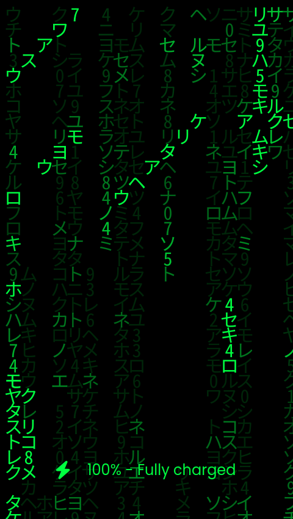 | 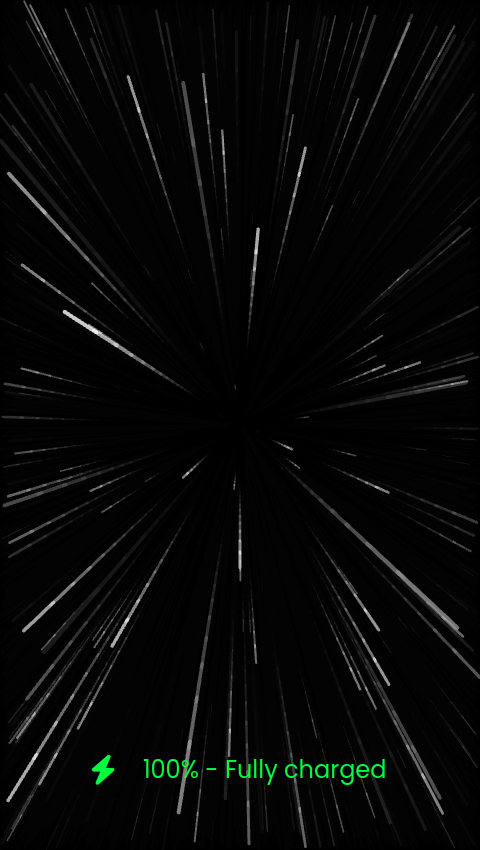 | 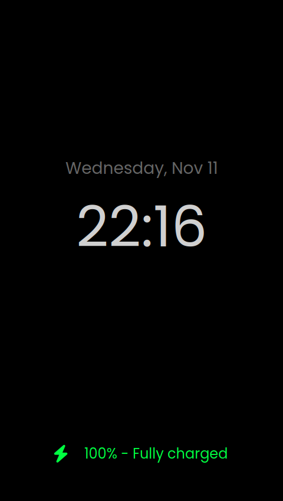 | 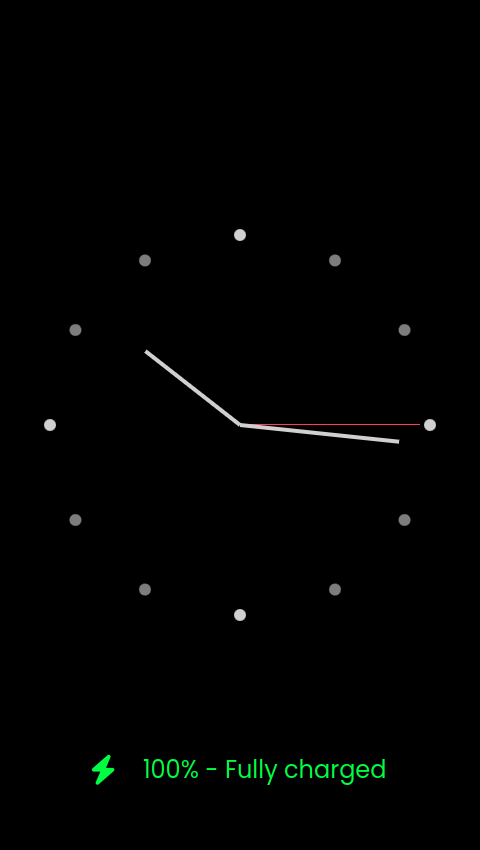 | 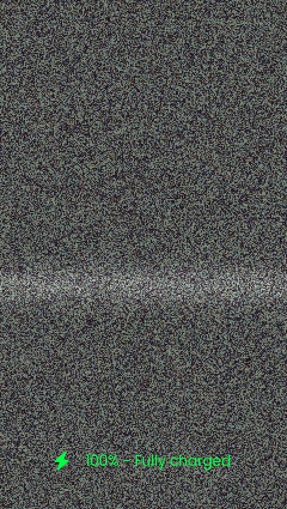 |
| Green rain with Characters set to Kana and Font size 30 | The star warp with its default settings | The date (Wednesday, Nov 11) above the time (22:16) | UC's clock face: 12 dots, the hour and minute hands and the red second hand | Snow with the lighter tracking bar crossing it |

### Screen-off animations

The styles are described in words, since each one is a short animation that a single frame doesn't show. They are picked on the Power Saving page:

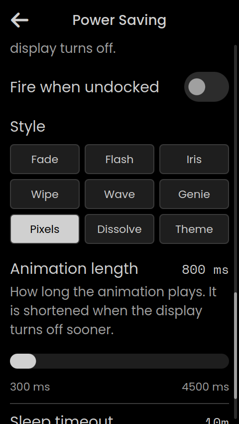

*Settings → Power Saving: the last line of the Screen off animations help text, Fire when undocked (off), Style with Pixels picked for this capture (the default is Theme), and Animation length (800 ms) with its help.*

- **Fade** — monotonic black ramp. Clean dim-to-nothing, no character. Safe baseline for any theme.
- **Flash** — a brief white full-screen pulse, then the screen fades to black (the pulse takes the first 40 % of the animation, the fade the rest). Classic "TV zap off".
- **Iris** — an oval black mask, with the screen's proportions, closes from the edges to the centre with a soft edge. Camera-shutter / old-cartoon feel.
- **Wipe** — solid black rectangle sweeps top-to-bottom, like an old film projector finishing a reel.
- **Wave** — soft cyan gradient wave travels downward, dimming everything behind it. The most "peaceful" of the set.
- **Genie** — the live theme shrinks and slides toward the bottom of the screen, darkening as it goes. It is a uniform shrink, not the curved ribbon of the macOS Genie effect, because this style only uses a fragment shader.
- **Pixels** — the live theme progressively pixelates into bigger and bigger blocks (0.5% → 8% of screen width), then the pixelated output fades to black. Looks like the image is being destroyed bit by bit.
- **Dissolve** — the live theme blends into per-pixel white noise, progressively shifting to pure noise, then the noise fades to black. Film-dissolve energy.
- **Theme** (the default) — the theme's own effect, on the two themes that have one. **TV Static** collapses like an old CRT: the snow and scanlines collapse into a bright horizontal line, the line shrinks to a dot and the dot fades to black (800 ms, then 500 ms of black); its clock and battery overlays stay on screen until the display turns off. **Analog** sweeps its hands to 12 and drops them to 6 while the face dims, then holds black (1300 ms in all; Shutdown hands on the Analog settings picks all three hands or minute and hour only). On Matrix, Starfield and Minimal, Theme draws nothing and the display turns off at its usual time. The effect is timed to end just before the display turns off, and the screensaver then switches the display off.

### Settings — Entry point

After installation, Settings gains a **Screensaver** entry (Unfolded Circle's stock UI has none); the next section shows the page behind it. The screensaver also adds rows to two stock pages: Screen off animations, Fire when undocked, Style and Animation length under **Power Saving**, and Dock chime and Chime after screensaver under **Sound & Haptic**.

| Settings menu | Sound & Haptic |
|:-------------:|:--------------:|
| 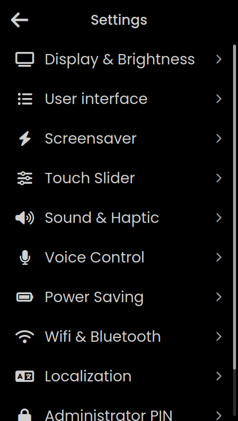 | 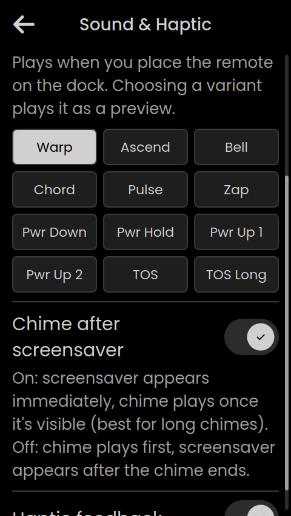 |
| The Settings menu, with Screensaver between User interface and Touch Slider | The end of the Dock chime row (its help and the 12 chimes, Warp chosen), Chime after screensaver (on) with its help, and the start of Haptic feedback |

### Settings — The Screensaver page

The page opens on the Theme picker. The clock rows (not on Minimal and Analog, which are clocks themselves) and the battery rows come next, then the rows of the chosen theme, and the page ends with the behavior rows. Most rows that belong to a switch show only while that switch is on (a few are greyed out instead), so some captures were taken with switches turned on; their captions say so.

#### Theme, clock and battery

| Theme and battery | Clock | Clock and date |
|:-----------------:|:-----:|:--------------:|
| 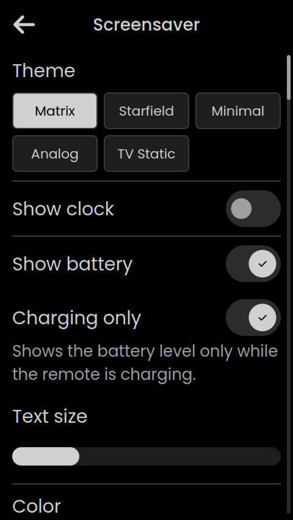 | 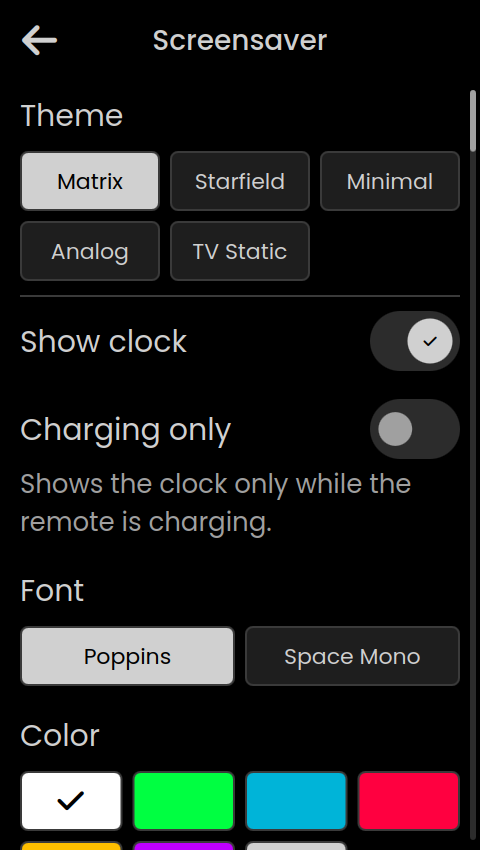 | 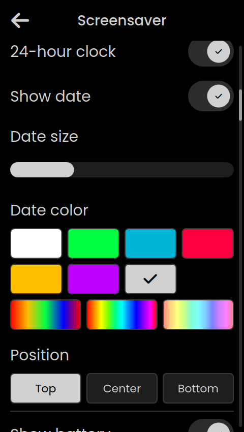 |
| Theme (Matrix chosen), Show clock (off), Show battery with Charging only and Text size, and the start of Matrix's Color row | Show clock turned on: Charging only (off) with its help, Font (Poppins / Space Mono), and the start of Color | 24-hour clock (on), Show date turned on with Date size and Date color, Position (Top / Center / Bottom), and the start of Show battery |

| The clock on the screensaver |
|:----------------------------:|
| 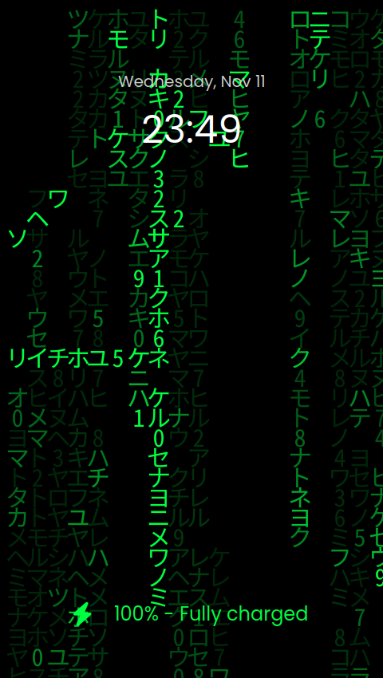 |
| Matrix (Kana, Font size 30) with Show clock and Show date turned on: the date (Wednesday, Nov 11) above the time (23:49) at the top, the battery at the bottom |

#### Matrix

The captures of the Glitch effect, Direction change, Chaos events (1) and (2), Tap effects (1) and (2), Subliminal messages and Hidden messages rows, and the Touch directions capture further down, were taken with Chaos events, Subliminal messages and Touch directions turned on, DPAD interactive off, and HELLO, WORLD, WAKE UP typed in as the hidden messages, so that the rows those settings hide show. The Auto-rotate, Depth glow, Color layers and two Screen wipe captures, and the Idle screensaver capture further down, come from a second run with the switches their captions name turned on and no hidden messages typed, which is why no Subliminal messages row shows above Hidden messages there.

| Color, characters, speed | Trails and direction | Glows and layers |
|:------------------------:|:--------------------:|:----------------:|
| 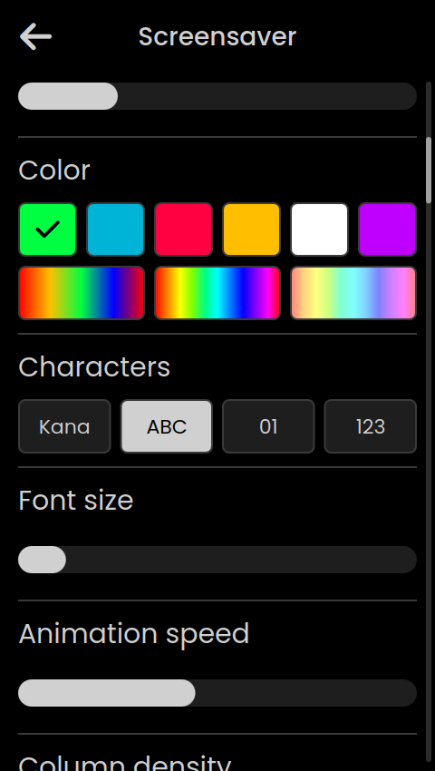 | 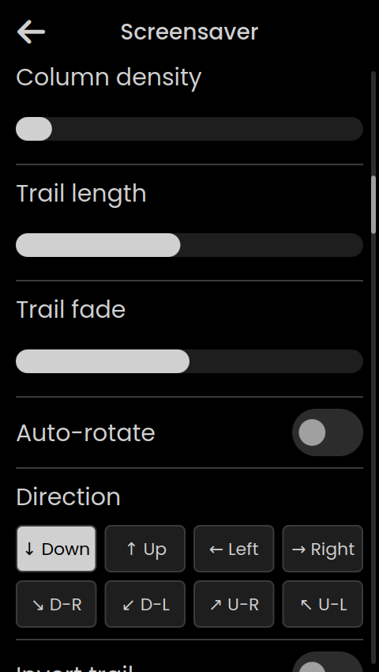 | 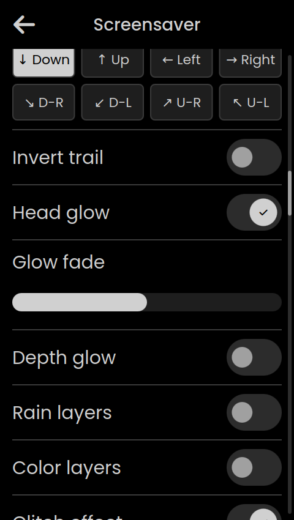 |
| Color (6 colors and 3 gradients, green chosen), Characters (Kana / ABC / 01 / 123, ABC chosen), Font size, Animation speed | Column density, Trail length, Trail fade, Auto-rotate (off), Direction (8 directions, Down chosen) | The end of Direction, then Invert trail (off), Head glow (on), Glow fade, Depth glow (off), Rain layers (off), Color layers (off) |

| Auto-rotate | Depth glow | Color layers |
|:-----------:|:----------:|:------------:|
| 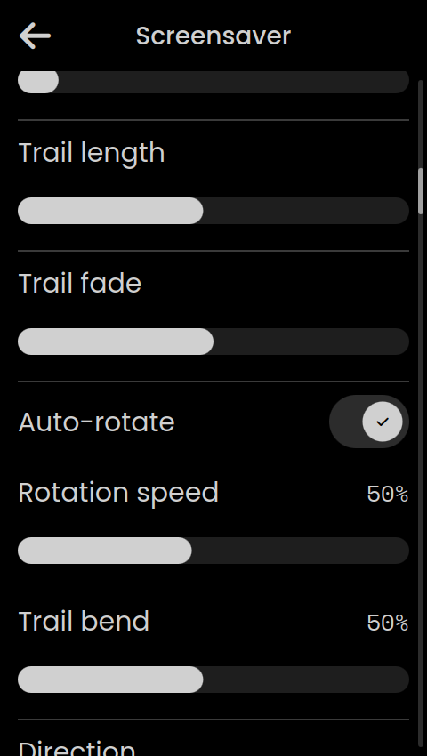 | 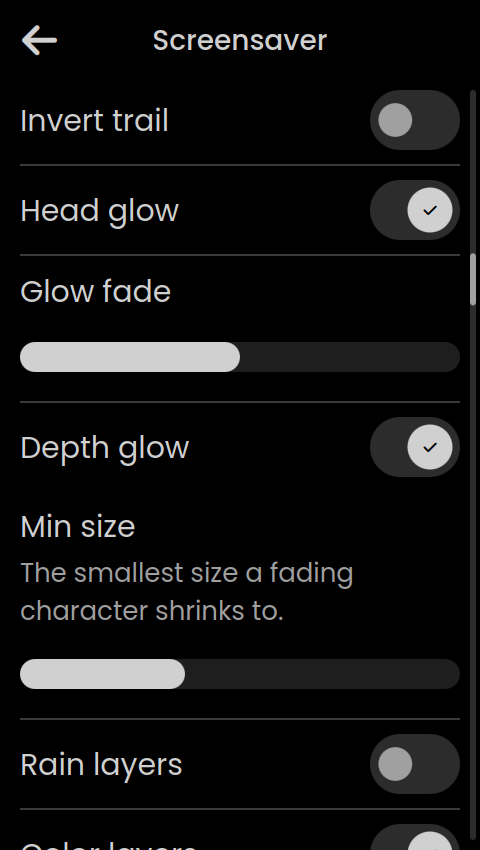 | 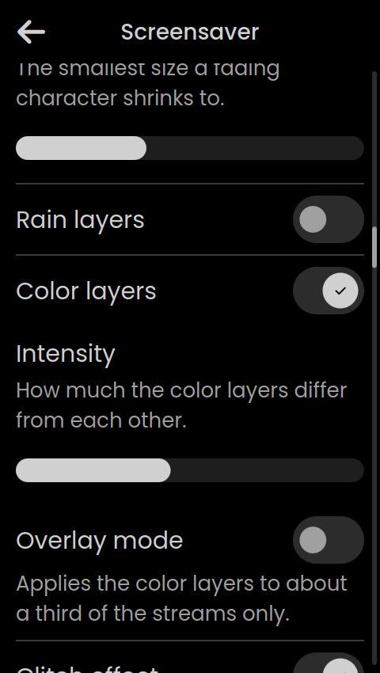 |
| Trail length, Trail fade, then Auto-rotate turned on: Rotation speed (50 %) and Trail bend (50 %) | Invert trail, Head glow, Glow fade, then Depth glow turned on: Min size with its help, and Rain layers | The end of Min size, Rain layers (off), then Color layers turned on: Intensity and Overlay mode (off), each with its help |

| Glitch effect | Direction change | Chaos events (1) |
|:-------------:|:----------------:|:----------------:|
| 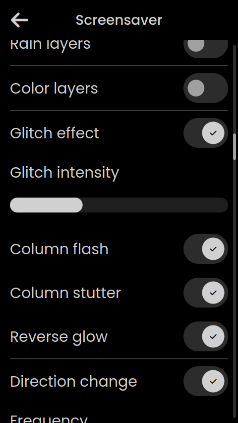 | 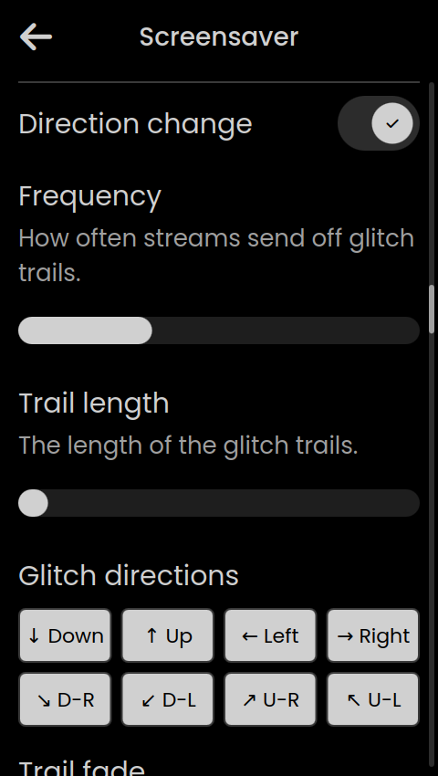 | 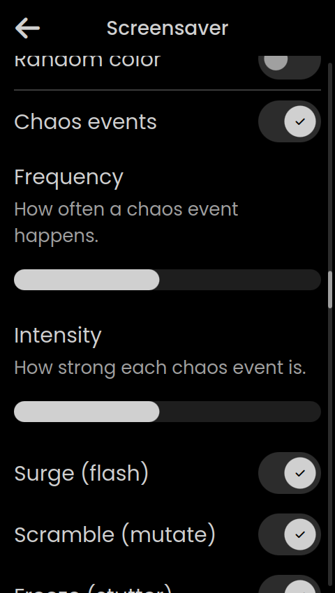 |
| Glitch effect (on) with Glitch intensity, Column flash, Column stutter and Reverse glow, then Direction change (on) | Direction change: Frequency and Trail length with their help, Glitch directions (all 8 on) | Random color (the end of Direction change), then Chaos events turned on: Frequency and Intensity with their help, Surge (flash), Scramble (mutate) |

| Chaos events (2) | Tap effects (1) | Tap effects (2) |
|:----------------:|:---------------:|:---------------:|
| 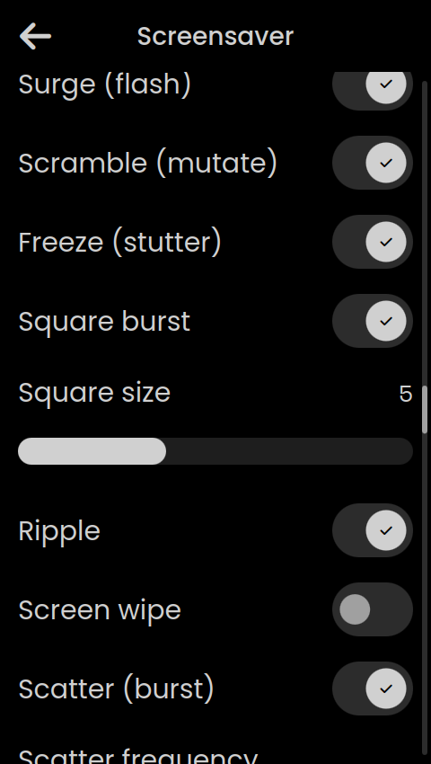 | 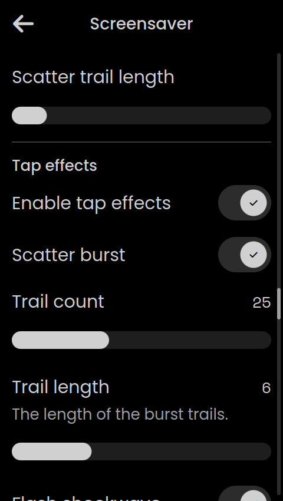 | 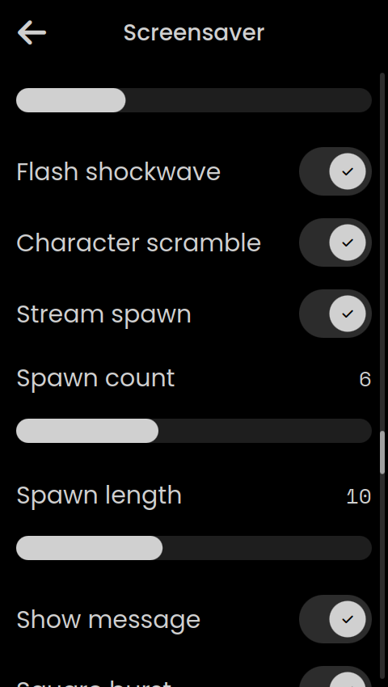 |
| Surge (flash), Scramble (mutate), Freeze (stutter), Square burst with Square size 5, Ripple, Screen wipe (off), Scatter (burst) | Scatter trail length, the Tap effects heading, Enable tap effects, Scatter burst with Trail count 25 and Trail length 6 | Flash shockwave, Character scramble, Stream spawn with Spawn count 6 and Spawn length 10, Show message |

| Screen wipe in Chaos events | Screen wipe in Tap effects, and Randomize |
|:---------------------------:|:-----------------------------------------:|
| 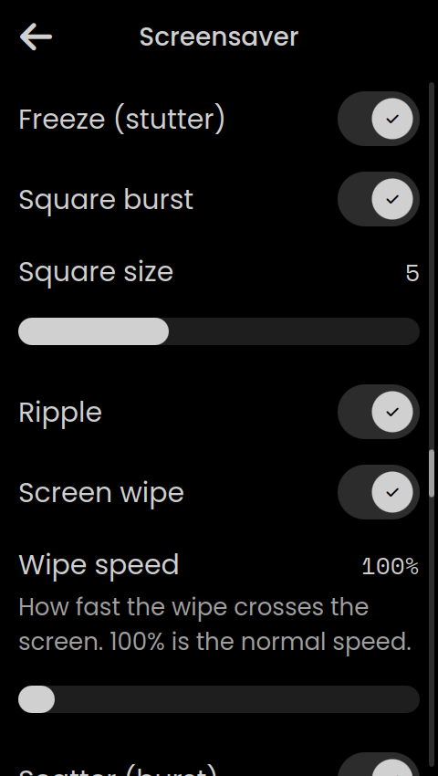 | 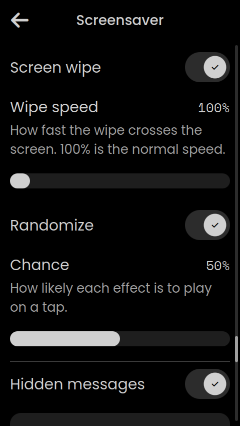 |
| Freeze (stutter), Square burst with Square size 5, Ripple, then Screen wipe turned on: Wipe speed (100 %) with its help | Screen wipe turned on: Wipe speed (100 %) with its help, then Randomize turned on: Chance (50 %) with its help, and Hidden messages |

| Subliminal messages | Hidden messages |
|:-------------------:|:---------------:|
| 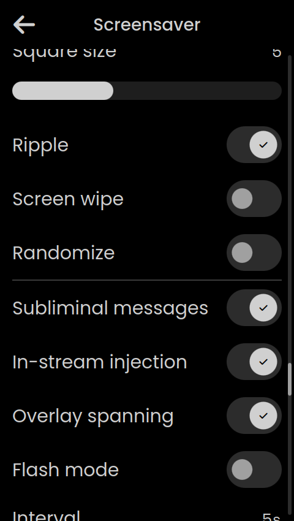 | 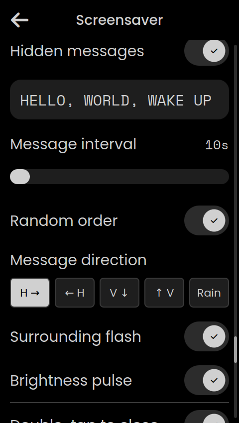 |
| The last tap rows (Square size 5, Ripple, Screen wipe off, Randomize off), then Subliminal messages turned on: In-stream injection, Overlay spanning, Flash mode (off) | Hidden messages with the text HELLO, WORLD, WAKE UP, Message interval (10 s), Random order, Message direction (H →, ← H, V ↓, ↑ V, Rain; H → chosen), Surrounding flash, Brightness pulse |

#### The behavior rows at the end of the page

| Behavior on Matrix (defaults) | Touch directions | Idle and docked rearm |
|:-----------------------------:|:----------------:|:---------------------:|
| 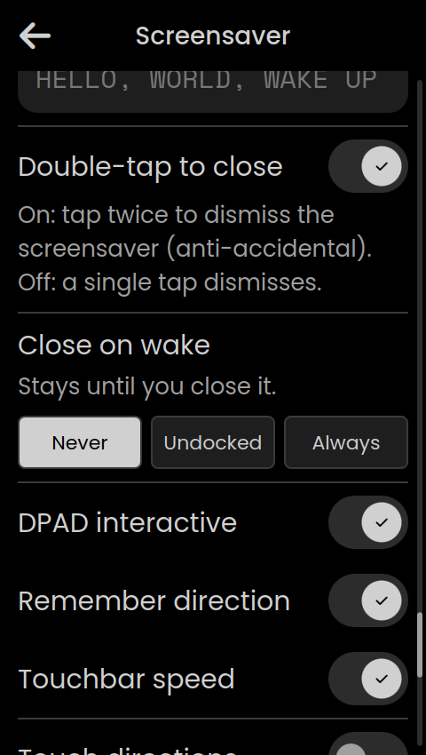 | 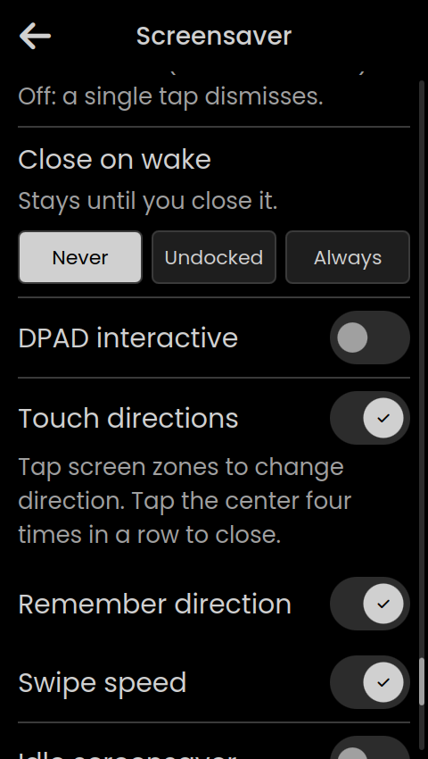 | 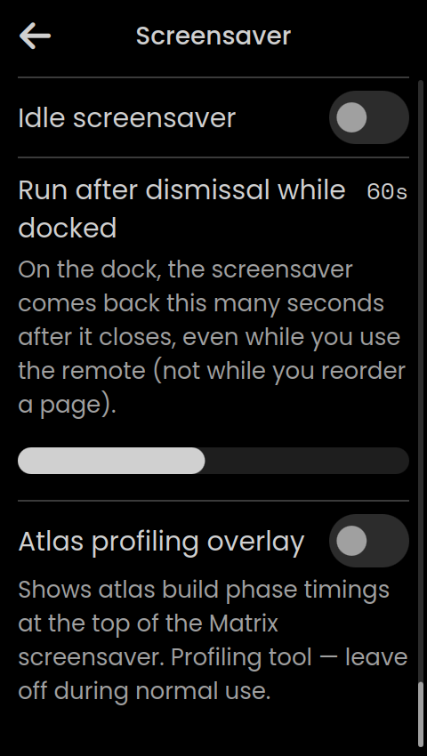 |
| The end of the Hidden messages box, empty (the grey HELLO, WORLD, WAKE UP is its placeholder), Double-tap to close with its help, Close on wake (Never), DPAD interactive with Remember direction and Touchbar speed, and the start of Touch directions | Close on wake (Never), DPAD interactive (off), Touch directions turned on with its help, Remember direction, Swipe speed | Idle screensaver (off), Run after dismissal while docked (60 s) with its help, Atlas profiling overlay (off, Matrix only) with its help |

| Idle screensaver turned on |
|:--------------------------:|
| 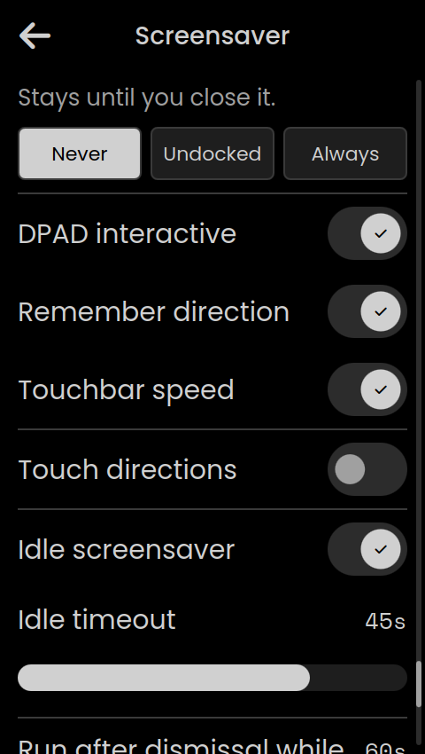 |
| Close on wake (Never), DPAD interactive with Remember direction and Touchbar speed, Touch directions (off), then Idle screensaver turned on: Idle timeout (45 s) |

#### Close on wake

| Never (default) | Undocked | Always |
|:---------------:|:--------:|:------:|
| 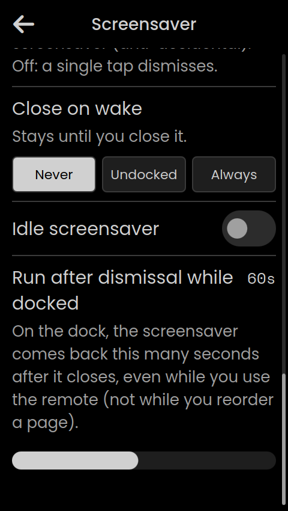 | 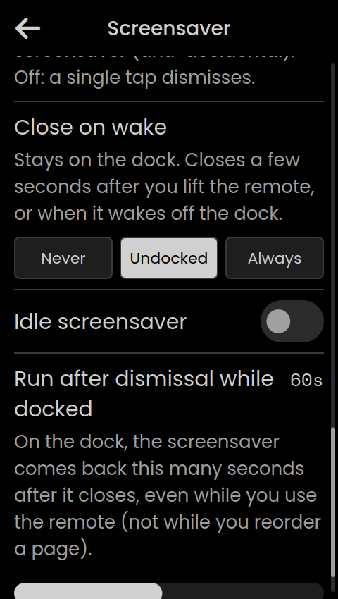 | 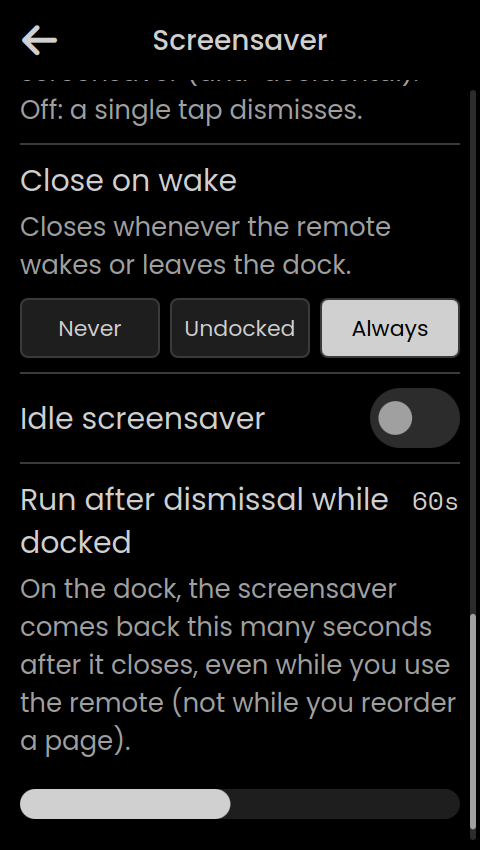 |
| "Stays until you close it." | "Stays on the dock. Closes a few seconds after you lift the remote, or when it wakes off the dock." | "Closes whenever the remote wakes or leaves the dock." |

The three captures are from the Minimal theme's page: the help line under Close on wake changes with the choice. Idle screensaver and Run after dismissal while docked follow it; the DPAD interactive and Touch directions rows are missing, as on every theme but Matrix.

#### Starfield

| Battery and speed | Size, trail and color |
|:-----------------:|:---------------------:|
| 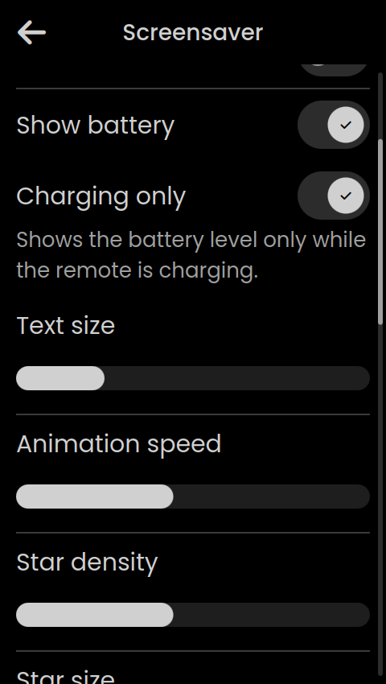 | 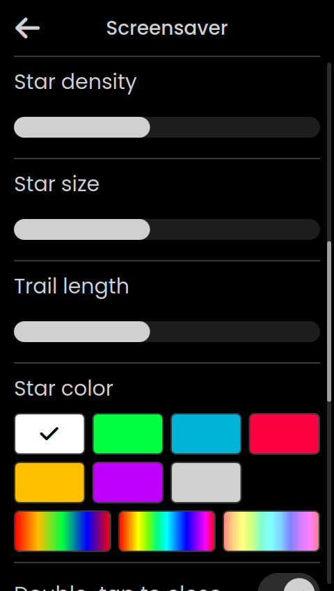 |
| Show battery with Charging only and Text size, then Animation speed and Star density | Star density, Star size, Trail length, Star color (7 colors and 3 gradients, white chosen) |

#### Minimal

| Clock and time color | Date color and sizes |
|:--------------------:|:--------------------:|
| 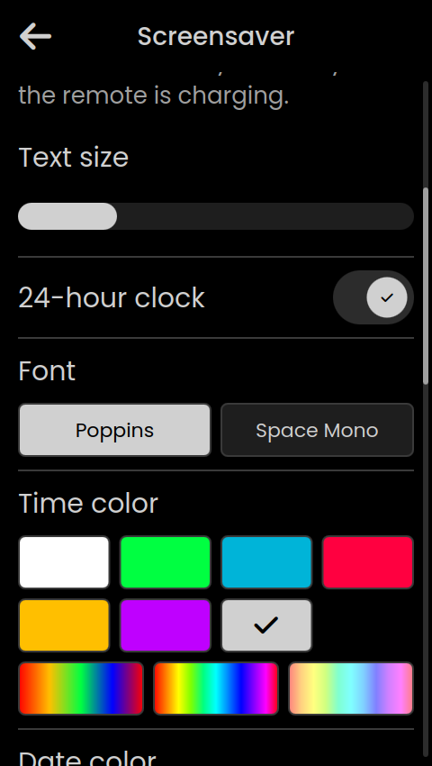 | 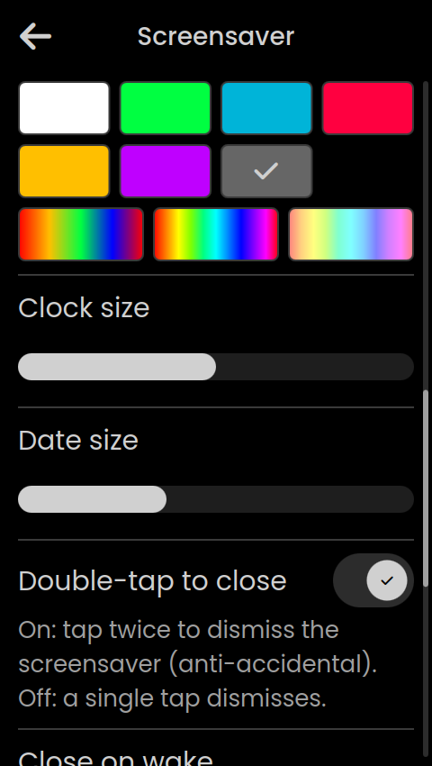 |
| The battery's Text size, then 24-hour clock (on), Font (Poppins chosen), Time color (light grey chosen) | Date color (dark grey chosen), Clock size, Date size, then Double-tap to close with its help |

#### Analog

| Shutdown hands |
|:--------------:|
| 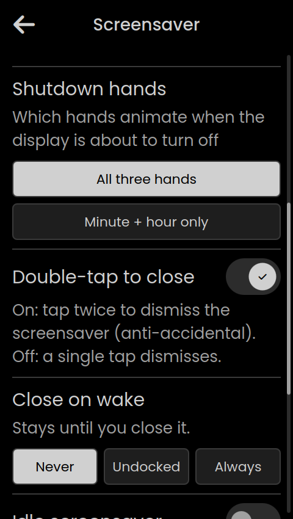 |
| Shutdown hands with its help (All three hands chosen, or Minute + hour only), then Double-tap to close and Close on wake (Never) |

#### TV Static

| Snow and scanlines | Tracking bar and tint | Channel flash (1) | Channel flash (2) |
|:------------------:|:---------------------:|:-----------------:|:-----------------:|
| 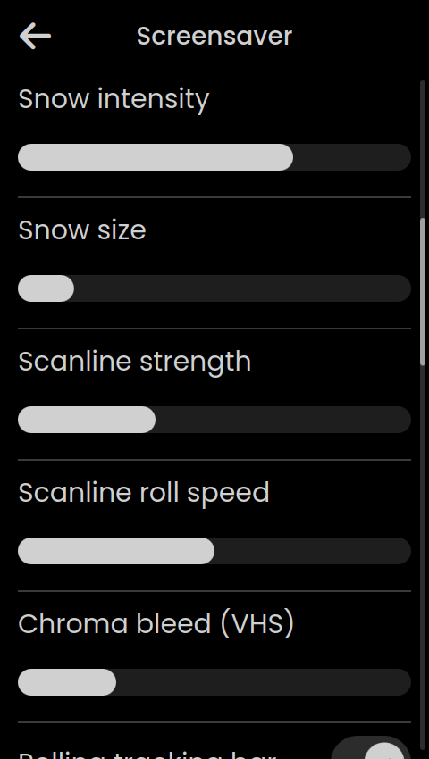 | 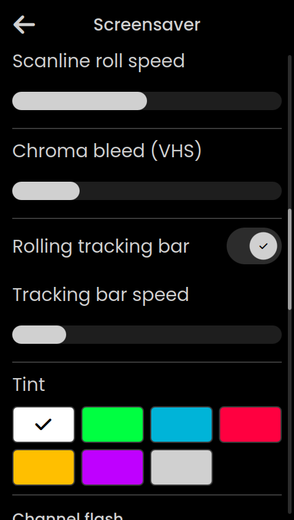 | 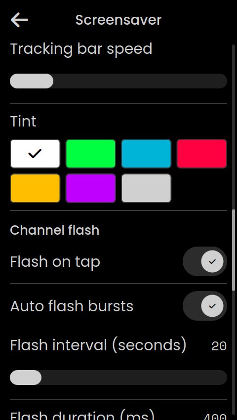 | 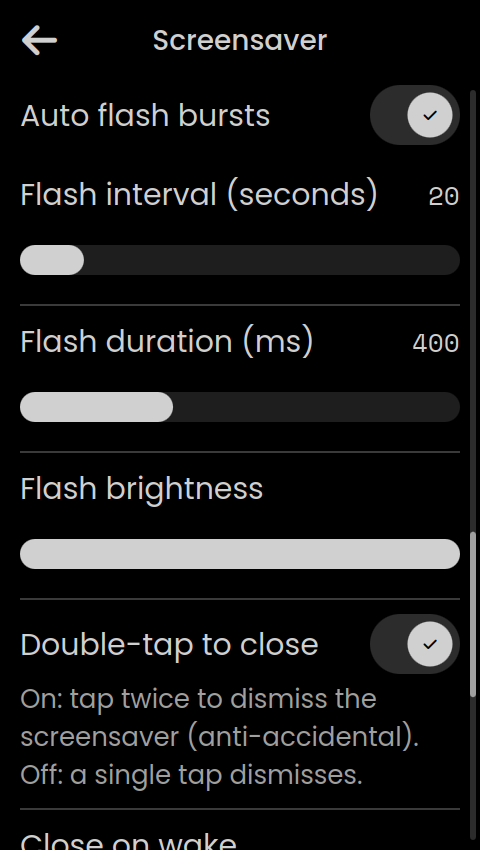 |
| Snow intensity, Snow size, Scanline strength, Scanline roll speed, Chroma bleed (VHS) | Scanline roll speed, Chroma bleed (VHS), Rolling tracking bar (on) with Tracking bar speed, Tint (7 colors, white chosen) | Tracking bar speed, Tint, the Channel flash heading, Flash on tap (on), Auto flash bursts (on), Flash interval (seconds) 20 | Auto flash bursts, Flash interval (seconds) 20, Flash duration (ms) 400, Flash brightness, then Double-tap to close |

## Features

### Themes

- **Matrix** (the default theme) — GPU-drawn falling character rain with full customization (see below)
- **Starfield** — animated star field with Animation speed, Star density, Star size and Trail length (each 10–100, default 50) and Star color (7 solid colors, white by default, + 3 rainbow gradients). On the screensaver, sliding a finger along the touch slider changes the star density. Swiping up or down on the screen changes the speed only while Touch directions and Swipe speed are on; both are set on the Matrix theme's settings page, and Touch directions is off by default.
- **Minimal** — clean digital clock with the date above it: 24-hour clock, Font (Poppins / Space Mono), Clock size, Date size, and separate Time color and Date color pickers (7 solid + 3 rainbow gradients each). The battery overlay is optional; the clock overlay isn't offered, since the theme is a clock.
- **Analog** — UC's stock analog clock face with hour dots and second/minute/hour hands (battery overlay optional). It has its own screen-off effect, set by Shutdown hands (see Screen-off Animations).
- **TV Static** — single-pass GPU fragment shader composing analog dead-channel snow, VHS chroma bleed, CRT scanlines, rolling vertical-hold tracking bar, and channel-flash bursts. Full visual and cadence control, and its own screen-off effect.

### Matrix

**Appearance:**
- Color — 9 color modes: Green (the default), Blue, Red, Amber, White, Purple and the gradients Rainbow, Rainbow+ (a smoother rainbow) and Neon (pastel). The swatches carry no names on the page; the names here are only for reading.
- Characters — Kana (Japanese katakana and digits), ABC (capital letters and digits, the default), 01 (binary), 123 (digits)
- Font size (10–60), Animation speed (10–100), Column density (20–500), Trail length (5–100) and Trail fade (20–100), all applied live
- Invert trail — bright tail instead of bright head
- **Head glow** — this switch currently changes nothing you can see: the brightest character of each stream (its head, or its tail end with Invert trail on) is drawn at full brightness either way.
- Glow fade (0–100) — how long a character keeps glowing after the stream has passed (0 = no afterglow)

**Visual Effects:**
- **Rain layers** (off by default) — 3 independent rain grids at different font sizes (far=small/slow, mid=normal, near=large/fast). Creates depth through physical size difference. The bright part of nearer rain hides the rain behind it, while faint tails stay see-through. Only the mid grid shows glitches, Chaos events, Hidden and Subliminal messages, tap effects and the OK button's burst.
- **Color layers** (off by default) — per-stream atmospheric color tinting via custom GPU shader (texture × per-vertex RGBA). Continuous gradient from dim teal (slow streams) to bright chartreuse (fast streams). Intensity sets how much the layers differ; Overlay mode tints only about a third of the streams.
- **Depth glow** (off by default) — residual glow characters shrink with age, so fading characters seem to recede. Min size (10–90 %) sets how small they get. Has no effect while Rain layers is on.

**Direction & Movement:**
- 8 directions (Down, the default, Up, Left, Right and the four diagonals) set by the Direction picker, the d-pad or the touch zones
- Auto-rotate (off by default) — the direction turns continuously through 360° with curved trails. Rotation speed and Trail bend (how tight the curve is) appear while it is on, and the Direction picker is greyed out.
- Each stream turns gradually, so a direction change draws curves instead of restarting the rain
- Streams fill the screen evenly in any direction, every column and row included

**Glitch Effects** (Glitch effect switch, on by default, with Glitch intensity 5–80):
- Character swap — trail characters randomly change (part of Glitch effect, no switch of its own)
- Brightness flicker — random trail characters briefly brighten (part of Glitch effect, no switch of its own)
- Column flash — a whole stream lights up at full brightness for a moment (a column when the rain runs up or down, a row when it runs sideways)
- Column stutter — a stream stops for a moment
- Reverse glow — dimmer characters further along a trail briefly brighten
- Direction change — glitch trails shoot off in the directions you pick (Frequency, Trail length, Glitch directions, Trail fade, Trail speed, Random color; at least one of the 8 Glitch directions stays on)

Column flash, Column stutter, Reverse glow and Direction change have their own switches. Turning Glitch effect off stops all of them, and the Chaos events too.

**Chaos Events** (Chaos events switch, off by default; it and its settings appear, and the events play, only while Glitch effect is on; now and then two events play together):
- Surge (flash) — every stream flashes at full brightness at once
- Scramble (mutate) — every character on screen keeps changing for a moment
- Freeze (stutter) — every stream pauses for a moment
- Square burst — an expanding square outline (Square size 2–10)
- Ripple — an expanding circular ring
- Screen wipe (off by default) — a brightness wave sweeps across the screen from a random side, edge to edge (Wipe speed 50–600 %)
- Scatter (burst) — bursts of glitch trails from random points, on a timer of their own (Scatter frequency, Scatter trail length)
- Frequency and Intensity set how often the other events come and how strong they are; each event type has its own switch

**Hidden Messages** (Hidden messages switch, on by default):
- The messages are words you type in the text box, separated by commas. Tap the box to type: the d-pad doesn't operate the on-screen keyboard. The box starts empty, so no message shows until you type one, and the rows below appear only once it has text.
- 5 message directions (Message direction) — H → (left to right), ← H (right to left), V ↓ (top to bottom), ↑ V (bottom to top) and Rain (along the rain)
- With Rain, a message runs across the screen for left/right rain and downwards for any other direction, and always reads left to right or top to bottom. ← H and ↑ V spell it backwards. Letters are never mirrored.
- Surrounding flash and Brightness pulse switches
- Message interval (5–60 s) and Random order

**Subliminal Messages** (Subliminal messages switch, off by default; it uses the Hidden messages text, and its settings appear only once you have typed some):
- In-stream injection — one of your messages is written into the trail of a single rain stream, one letter per character, just behind its head
- Overlay spanning — a whole message laid across the screen
- With In-stream injection and Overlay spanning both on, each message uses one of the two at random
- Flash mode (off by default) — in-stream letters light up at full brightness while they last; an overlay message is always drawn bright, and with Flash mode it stays a fixed 40 rain steps (about 2 s at the default Animation speed) instead of half the Duration
- Interval (1–30 s) between messages, and Duration (2–40 rain steps; a step is 50 ms at the default Animation speed)

**Tap Interaction:**
- **Enable tap effects** — one switch for all the effects below (default on). With it off, a tap plays none of them (it still cancels a screen-off animation) and the other rows are hidden. With Touch directions on, taps still turn the rain and centre taps still act like the OK button.
- When a tap plays them: with Double-tap to close on (the default), a single tap plays them at the tap point after 0.3 s; with Touch directions on, every edge-zone tap and the first two centre taps play them at once. With both off, a single tap closes the screensaver, so no tap effect plays.
- The effects (all on by default except Screen wipe):
  - Scatter burst (glitch trails explode from the tap) — Trail count (10–50) and Trail length (2–15)
  - Flash shockwave (nearby streams flash)
  - Character scramble (randomize the characters around the tap)
  - Stream spawn (Spawn count, Spawn length) — meant to start new streams at the tap point; in this version it has no visible effect (it never finds a free stream to reuse), so Spawn count and Spawn length change nothing; with Randomize on, the Stream spawn switch only adds taps that show nothing (see Randomize)
  - Show message (one of your Hidden messages at the tap point; nothing until you have typed at least one)
  - Square burst (expanding square outline) — Square size (2–10)
  - Ripple (expanding circular ring)
  - Screen wipe (off by default; a brightness sweep from the edge on the tapped side to the other edge) — Wipe speed (50–600 %)
- Randomize (off by default) — each enabled effect plays with the probability set by Chance (10–90 %, default 50 %); at least one always plays, but it can be Stream spawn, or Show message before you have typed a message, so a tap can show nothing

**Touch-Zone Directions** (Touch directions switch, off by default):
- The screen is split into a 3×3 grid: tap one of the 8 edge zones to turn the rain that way; every edge tap also plays your tap effects
- Centre zone (each tap within 0.4 s of the last): taps 1 and 2 play your tap effects and act like the OK button (a burst; two taps within 0.3 s count as a double press and restore the direction), tap 3 restores the direction, tap 4 closes the screensaver
- Double-tap to close doesn't apply while Touch directions is on
- Meant as an alternative to DPAD interactive, but Settings doesn't switch DPAD interactive off when you turn Touch directions on, so both can be on. Then taps use the zones, the d-pad, volume and channel buttons still steer the rain, and the touch slider no longer changes the speed.
- Remember direction — reopens the screensaver with the last direction you set; it is the same setting as Remember direction under DPAD interactive

**Swipe & Hold Gestures:**
- Swipe up or down — changes the rain speed (up = faster, 1 step per 10 px of swipe) while Touch directions and Swipe speed (on by default) are on; on Starfield it changes the star speed
- Hold — keep a finger still on the screen: after 0.5 s the rain runs 3× slower, at 1.5 s it stops; lifting the finger resumes it. Matrix only, with or without Touch directions.

**DPAD Interaction** (DPAD interactive switch, on by default; it is shown on the Matrix page only but applies to every theme, see Closing the screensaver):
- The d-pad arrows turn the rain in real time; VOLUME+ / VOLUME− give up-left / down-left and CHANNEL+ / CHANNEL− give up-right / down-right
- A d-pad direction overrides Auto-rotate until you restore it
- OK (centre) button: one press = a burst — a chaos event when Chaos events is on, otherwise every stream flashes (nothing with Glitch effect off); two presses within 0.3 s = back to the set direction (or to Auto-rotate); hold for 0.5 s = rain at a third of its speed until you let go
- Remember direction (on by default) — reopens the screensaver with the last direction you set
- Touchbar speed (on by default, shown while DPAD interactive is on) — slide a finger along the touch slider to change the Animation speed; a red "Speed" label shows the new value for 1.2 s. It doesn't work while Touch directions is on. v1.4.8 made it three times less sensitive than before.
- With DPAD interactive off, these nine buttons (the four arrows, OK, VOLUME+/− and CHANNEL+/−) close the screensaver instead

### TV Static

**Visual composition (single GPU fragment-shader pass):**
- **Luma snow** — hash-based per-pixel grayscale noise. Snow intensity (0–100) and Snow size (1–8 px cells, quantized for that chunky "big pixel" analog feel)
- **VHS chroma bleed** — faint offset hash lookups in R and B channels produce the red/blue chroma ringing of an old VHS tape (Chroma bleed (VHS), 0–100)
- **CRT scanlines** — every other pixel row is darkened (Scanline strength, 0–100). Scanline roll speed (−100 to 100, 0 = still) makes the darkened rows swap with the rows between them instead of rolling, because they are only one pixel apart: the swapping is fastest around ±25 and ±75 (about 30 times a second) and almost stops at ±50 and ±100, and a negative value looks exactly like the positive one.
- **Rolling tracking bar** (on by default) — Gaussian soft band drifting down the screen like VHS vertical-hold drift (Tracking bar speed, 0–200)
- **Channel-flash bursts** — bright white flash overlays, under the Channel flash heading:
  - Flash on tap — despite the name, tapping the screen does not flash (a tap only counts toward closing the screensaver). While DPAD interactive is on (the default; it is set on the Matrix theme's settings page), the d-pad arrows and the volume and channel buttons fire the flash instead of closing the screensaver; OK does nothing. A flash also plays once when TV Static opens while a direction is remembered (Remember direction).
  - Auto flash bursts — a flash every Flash interval (3–120 s, with ±50 % randomness)
  - Flash duration (80–1000 ms)
  - Flash brightness (0–100 %)
- **Tint** — 7 solid swatches (white, matrix green, neon blue, red, amber, purple, grey) tint the whole frame; the flashes stay white

### Overlays

- **Clock** (Matrix, Starfield and TV Static; Minimal and Analog are clocks themselves) — Show clock (off by default), then Charging only (off by default; on, the clock shows only while the remote is on the charger), Font (Poppins / Space Mono), Color (7 solid + 3 rainbow gradients), Size (24–96), 24-hour clock, Show date with its own Date size (12–40) and **Date color** (7 solid + 3 rainbow gradients), and Position (Top / Center / Bottom)
- **Battery** (every theme) — Show battery (on by default): the level in five colors as it drops (green, then light green below 86 %, yellow below 61 %, orange below 31 %, red below 16 %), with "NN% - Charging" while it charges, "100% - Fully charged" once it is full and has stopped charging, and "NN%" otherwise; Text size (16–48); Charging only (on by default) shows it only while the remote is on the charger

### Screen-off Animations

A short animation on the screensaver just before the display turns off. It plays only while the screensaver is showing, on the dock (and off it too with Fire when undocked). With the default style, Theme, only TV Static and Analog play one.

**How it's triggered:** the core's `Normal → Idle` power-mode transition starts the dim phase (the display dims). Its shortest length follows from the Display off timeout T: `T − max(T/2, 3)` seconds, measured on the core. A drawn style starts so it ends 250 ms before the earliest switch-off; an Animation length that doesn't fit is shortened, and with under 300 ms left it is skipped. A theme's own effect (TV Static, Analog) keeps its length: on a screensaver that opens too late in the dim phase it starts at once, and the switch-off can cut it short. When the animation ends, the screensaver switches the display off itself, so no black but lit screen lingers. Waking the remote during the animation cancels it. There is no polling fallback: firmware 2.12.0 and later always pass through `Idle`. *(Rewritten 2026-11-03: the earlier per-cycle measurement and 200 ms poller are gone.)*

**Tier 1 — Shared overlay (any theme)**, 8 styles:

*Draw-over styles (no theme sampling — zero GPU overhead beyond the shader pass):*
- **Fade** — simple monotonic black ramp. Safe baseline.
- **Flash** — a white flash in the first 40 % of the animation, then a fade to black. Like an old TV being switched off.
- **Iris** — an oval black mask, stretched to the screen's proportions, closes from the edges to the centre with a soft edge. (Uses a small inline GLSL shader for the mask.)
- **Wipe** — black rectangle sweeps top-to-bottom like an old film projector.
- **Wave** — soft cyan gradient wave travels from top to bottom, dimming everything behind it.

*Theme-sampling styles (distort the underlying theme's rendering via a captured-texture shader):*
- **Genie** — the theme's picture shrinks toward the middle of the bottom edge and fades out, with black around it. It is one uniform shrink in a fragment shader (an inverse-scale UV transform), not a bending genie ribbon. Qt 5.15 can draw a bending one with a vertex shader (Qt's own Shader Effects example has a genie); this style doesn't.
- **Pixels** — theme progressively pixelates into bigger and bigger blocks (0.5% → 8% of screen width), then the pixelated output fades to black.
- **Dissolve** — theme blends into per-pixel white noise, progressively shifting to pure noise, then the noise fades to black.

Genie, Pixels and Dissolve draw from a capture of the theme's picture, kept in an off-screen image. The capture runs only while one of these styles plays; the image is created the first time one plays and kept until the screensaver closes. The other styles and "Theme" never start the capture.

**Tier 2 — Theme-native animations**: a theme can bring a shutdown effect of its own (the protocol is under Technical Details). Two themes use it: **TV Static**, a classic **CRT collapse** (the snow and scanlines collapse vertically into a bright horizontal line, the line shrinks to a single dot, the dot fades to black; 800 ms collapse + 500 ms black hold), and **Analog**, whose hands sweep to 12 and fall to 6 as the clock fades to black (1300 ms; Settings → Screensaver → Shutdown hands: All three hands, or Minute + hour only, where the second hand fades out instead). Both play with the "Theme" style and keep their own length.

The other themes (Matrix, Starfield, Minimal) use the Tier 1 shared overlay only; with "Theme" selected they draw nothing and the screen goes off at its usual time. Matrix briefly had a native cascade prototype in earlier builds; it was rolled back in v1.2.1 because the running-binding pause/resume race on wake left the rain area black across multiple cycles. The shared styles are architecturally simpler, work reliably on every theme, and don't fight Qt's scene graph lifecycle.

**Controls:** Settings → Power Saving, below Display off timeout:
- **Screen off animations** — the switch for the whole feature (default on); the rows below are greyed out while it is off
- **Fire when undocked** — also plays the animation when the remote is off the dock (default off). It only plays on a screensaver that is already showing off the dock: one that Idle screensaver opened (Settings → Screensaver), or one still showing after you lifted the remote (Close on wake set to Never).
- **Style** — Fade / Flash / Iris / Wipe / Wave / Genie / Pixels / Dissolve / Theme (default Theme). "Theme" uses the theme's own effect if it has one (TV Static, Analog); on a theme without one (Matrix, Starfield, Minimal) nothing is drawn and the screen goes off at its usual time.
- **Animation length** — how long the drawn styles play, 300–4500 ms (default 800). Hidden for "Theme". Shortened when the display turns off sooner (a short Display off timeout, or a screensaver that opens late), so the animation still finishes; skipped with under 300 ms left.

### When the screensaver opens

- **On the dock** — putting the remote on its dock, charger or Qi pad opens the chosen theme instead of Unfolded Circle's charging screen (an analog clock), with the dock chime. A wake from display-off or standby (not from a dimmed screen) while the remote is charging opens it again when it isn't showing, as in the stock UI. When the UI starts with the remote already on the charger, the screensaver opens after 2 s, without the chime.
- **Idle screensaver** (off by default; the stock UI has no idle screensaver) — off the charger, the screensaver opens after Idle timeout (15–55 s, default 45) with no key press, screen touch or touch-slider press. A wake restarts the countdown. After the UI starts off the charger with Idle screensaver on (after an install or a reboot, for example), the countdown doesn't run until the first wake (a touch on a dimmed screen counts), a lift off the charger, or Idle screensaver switched off and on again (found by reading the code, not tested).
- **Run after dismissal while docked** — "On the dock, the screensaver comes back this many seconds after it closes, even while you use the remote (not while you reorder a page)." The slider runs from 5 to 120 s (default 60) and has no off position; it works whether Idle screensaver is on or off. Any close on the dock starts it: a tap, a button, or a wake when Close on wake is set to Always. Using the remote doesn't restart the countdown. Lifting the remote cancels it, and so does a wake that opens the screensaver again. If the time runs out while you are reordering a page, the screensaver doesn't come back that way.
- **Dock chime** (Settings → Sound & Haptic) — Dock chime picks one of 12 chimes: Warp (the default), Ascend, Bell, Chord, Pulse, Zap, Pwr Down, Pwr Hold, Pwr Up 1, Pwr Up 2, TOS and TOS Long; picking one plays it. The chimes come with this UI as sound files in its install bundle: Warp, Ascend, Bell, Chord, Pulse and Zap were generated for it and last half a second or less; the other six last about 1 to 3 s. The chosen chime plays when you put the remote on the dock, follows UC's Sound effects switch and Sound effects volume, and doesn't play when the UI starts with the remote already on the charger. With **Chime after screensaver** on (the default), the screensaver appears at once and the chime plays once it is visible; with it off, the chime plays first and the screensaver appears after it. If the screensaver is already showing when you put the remote on the dock (for example after a lift with Close on wake set to Never), that dock plays no chime with Chime after screensaver on. *(Unreleased: before, that chime played later, at an unrelated opening of the screensaver.)*

### Closing the screensaver

- **Taps** — with **Double-tap to close** on (the default), two taps within 0.3 s close the screensaver; on Matrix a single tap plays the tap effects after 0.3 s, on the other themes it does nothing. With it off, a single tap closes it at once, as in the stock UI. With **Touch directions** on (Matrix only), tap the centre of the screen four times instead, each tap within 0.4 s of the last.
- **Remote buttons** — BACK, HOME, VOICE, MENU, MUTE, POWER, PREV, PLAY, NEXT, STOP and RECORD always close the screensaver, and so do the color buttons on a remote that has them. The d-pad (the four arrows and OK), VOLUME+/− and CHANNEL+/− close it only while **DPAD interactive** is off. DPAD interactive is on by default, and although its switch is shown only on the Matrix theme's settings page, it applies to every theme: while it is on, those nine buttons never close the screensaver. On Matrix they steer the rain (see DPAD Interaction); on TV Static the arrows, volume and channel buttons fire a channel flash (with Flash on tap on); on Starfield, Minimal and Analog they only stop a screen-off animation that is playing. With Remember direction on (the default), the arrows and the volume and channel buttons also store a direction on every theme: the next Matrix screensaver opens with it, and TV Static flashes once when it opens (with Flash on tap on). OK does nothing outside Matrix. To have these buttons close the screensaver on another theme, pick Matrix, turn DPAD interactive off, then pick your theme again.
- **Close on wake** — whether the screensaver also closes by itself; see the next section.

### Close on wake

*Unreleased: up to v1.6.3 this was an on/off switch.* Settings → Screensaver → **Close on wake** decides whether the screensaver closes by itself when the remote wakes up or the charger goes away. Taps and buttons close it as described above with every choice.

| Choice | Help line on the page | What happens |
|---|---|---|
| **Never** (default) | "Stays until you close it." | Nothing closes it by itself. It also stays when you lift the remote off the dock: Unfolded Circle's charging screen closes whenever the charger goes away, but this fork's default hasn't done so since v1.2.2. |
| **Undocked** | "Stays on the dock. Closes a few seconds after you lift the remote, or when it wakes off the dock." | A wake while the charger is reported (a touch, a bump of the table) leaves it showing. The report that the charger is gone closes it, and so does a wake while no charger is reported (for example on a screensaver that Idle screensaver opened). A screensaver that is still loading at that moment is stopped, so it can't open in your hand. |
| **Always** | "Closes whenever the remote wakes or leaves the dock." | Every wake closes it, on the dock too, and so does the report that the charger is gone. This is the old switch's "on". A screensaver that is still loading at that moment is left to open, as in v1.6.3. |

Undocked follows Unfolded Circle's own rule for its charging screen: it closes when the charger goes away, and a wake on the charger doesn't close it.

Limits:
- **The lift delay.** The screensaver learns that you lifted the remote only from the core's battery report. The core checks the battery about every 5 s and reports only changes, so when a lift wakes the remote, the wake comes first and the report follows. On the maintainer's Remote 3 on its Qi pad, the report came 2.3–4.6 s after the wake (13 lifts recorded from 2026-08-28 to 2026-11-11, median 3.3 s). With Undocked, the screensaver stays in your hand that long.
- **Buttons in that window.** A button pressed before the report goes to the screensaver: most buttons only close it, and with DPAD interactive on, the d-pad, volume and channel buttons don't even do that (see Remote buttons). Your button mappings don't run then. That is worked out from the code and not yet tried on a remote.
- **Qi pads.** On a Qi pad the core also reports the charger gone when charging stops while the remote still lies on the pad (on the maintainer's pad at 80 %, and once when full). Undocked and Always then close the screensaver too; Never keeps it.
- **Testing.** So far checked in the desktop simulator only. Not tested on a Remote Two.
- **Settings carry over.** A setting saved by v1.6.3 or older reads as before: the old switch's off is Never, its on is Always. After a downgrade to v1.6.3, Undocked shows as the switch on.

### General Behavior

- **Touch slider isolation** — while the screensaver shows, the touch slider doesn't change the volume, seek position, brightness or position of the device behind it; it controls the screensaver instead (Matrix: Animation speed, with DPAD interactive and Touchbar speed on and Touch directions off; Starfield: Star density). *Fixed in v1.4.7:* before, only the press was blocked, and the move and release still changed the device (Kodi's volume was overwritten on release). One gap remains (found by reading the code, not tested): a slide that is already under way when the screensaver opens is not cut off, so it can keep changing the device until the touch slider is next used outside the screensaver.
- **Display power gating** — while the display is off, Matrix stops its animation timer, Starfield and TV Static keep their timers running but skip the drawing, and the Minimal and Analog clocks keep following the time. Everything draws again when the display comes back on.
- **Atlas profiling overlay** (Matrix only, off by default) — a small green text strip at the top of the Matrix rain with the timings of the last glyph-atlas build. A profiling tool: leave it off in normal use.
- **Language** — the screensaver's own texts (the Screensaver page, its rows on Power Saving and Sound & Haptic, the battery overlay's text) are in English in every UI language: this fork edits only the English translation file ([ADR 0006](docs/adr/0006-en-us-ts-is-the-only-edited-translation.md)).

## Settings Reference

Most settings are in **Settings → Screensaver** on the remote; the screen-off animation is in **Settings → Power Saving** and the dock chime in **Settings → Sound & Haptic**. "While on" and "+" mark rows that belong to the switch before them: they appear only while it is on, unless the table says they are greyed out instead. The Screensaver page has no section headings apart from Tap effects (Matrix) and Channel flash (TV Static); the group names below are only for reading. The Screensaver rows are listed in page order, and the Themes column says on which theme's page they appear. The Screensaver page also works with the d-pad: every row that isn't greyed out can be reached with it, and while you use the keypad the focused row scrolls into view with its title and help. Typing the hidden messages needs touch.

| Group | Rows | Themes |
|-------|------|--------|
| Theme | Theme (Matrix / Starfield / Minimal / Analog / TV Static) | All |
| Clock | Show clock (while on: Charging only, Font (Poppins / Space Mono), Color (7 solid + 3 rainbow), Size, 24-hour clock, Show date (while on: Date size, Date color (7 solid + 3 rainbow)), Position (Top / Center / Bottom)) | Matrix, Starfield, TV Static |
| Battery | Show battery (while on: Charging only, Text size) | All |
| Appearance | Color (6 solid + 3 rainbow), Characters (Kana / ABC / 01 / 123), Font size, Animation speed, Column density, Trail length, Trail fade | Matrix |
| Direction | Auto-rotate (while on: Rotation speed, Trail bend), Direction (8 directions; greyed out while Auto-rotate is on) | Matrix |
| Visual | Invert trail, Head glow, Glow fade, Depth glow (while on: Min size), Rain layers, Color layers (while on: Intensity, Overlay mode) | Matrix |
| Glitch | Glitch effect (while on: Glitch intensity, Column flash, Column stutter, Reverse glow, and the Direction change and Chaos events groups below) | Matrix |
| Direction change (only while Glitch effect is on) | Direction change (while on: Frequency, Trail length, Glitch directions (8 directions, at least one stays on), Trail fade, Trail speed, Random color) | Matrix |
| Chaos events (only while Glitch effect is on) | Chaos events (while on: Frequency, Intensity, Surge (flash), Scramble (mutate), Freeze (stutter), Square burst (+ Square size), Ripple, Screen wipe (+ Wipe speed), Scatter (burst) (+ Scatter frequency, Scatter trail length)) | Matrix |
| Tap effects | Enable tap effects (while on: Scatter burst (+ Trail count, Trail length), Flash shockwave, Character scramble, Stream spawn (+ Spawn count, Spawn length), Show message, Square burst (+ Square size), Ripple, Screen wipe (+ Wipe speed), Randomize (+ Chance)) | Matrix |
| Subliminal | Subliminal messages, shown once the Hidden messages text box has text (while on: In-stream injection, Overlay spanning, Flash mode, Interval, Duration) | Matrix |
| Hidden messages | Hidden messages (while on: the message text box, and once it has text: Message interval, Random order, Message direction (H → / ← H / V ↓ / ↑ V / Rain), Surrounding flash, Brightness pulse) | Matrix |
| Starfield | Animation speed, Star density, Star size, Trail length, Star color (7 solid + 3 rainbow) | Starfield |
| Minimal | 24-hour clock, Font (Poppins / Space Mono), Time color (7 solid + 3 rainbow), Date color (7 solid + 3 rainbow), Clock size, Date size | Minimal |
| Analog | Shutdown hands (All three hands / Minute + hour only): which hands move in Analog's own screen-off effect, used when the Screen off animations Style is Theme | Analog |
| TV Static | Snow intensity, Snow size (1–8 px), Scanline strength, Scanline roll speed, Chroma bleed (VHS), Rolling tracking bar (+ Tracking bar speed, greyed out while the bar is off), Tint (7 solid); under the Channel flash heading: Flash on tap (see TV Static above: a screen tap doesn't flash), Auto flash bursts (+ Flash interval (seconds), greyed out while it is off), Flash duration (ms), Flash brightness | TV Static |
| Behavior | Double-tap to close, Close on wake (Never / Undocked / Always; default Never) | All |
| Interaction | DPAD interactive (while on: Remember direction, Touchbar speed), Touch directions (while on: Remember direction, Swipe speed) | Shown only on the Matrix page (see the note below) |
| Behavior | Idle screensaver (while on: Idle timeout, 15–55 s), Run after dismissal while docked (5–120 s) | All |
| Profiling | Atlas profiling overlay | Matrix |
| Screen off animations | Screen off animations, Fire when undocked, Style (Fade / Flash / Iris / Wipe / Wave / Genie / Pixels / Dissolve / Theme), Animation length (300–4500 ms; hidden for Theme); the rows after the switch are greyed out while it is off | All; Theme plays only on TV Static and Analog. In **Settings → Power Saving**, not Screensaver |
| Dock chime | Dock chime (Warp, Ascend, Bell, Chord, Pulse, Zap, Pwr Down, Pwr Hold, Pwr Up 1, Pwr Up 2, TOS, TOS Long; picking one plays it), Chime after screensaver | All. In **Settings → Sound & Haptic**, not Screensaver |

**DPAD interactive and Touch directions:** only the Matrix page shows these rows, but DPAD interactive (on by default) applies to every theme: while it is on, the d-pad (arrows and OK) and the volume and channel buttons don't close the screensaver on any theme (see Closing the screensaver). The two Remember direction switches are one setting. Touch directions with Swipe speed also lets a swipe up or down change the Starfield speed, and on Starfield the touch slider always changes the star density. DPAD interactive and Touch directions can both be on; the touch slider then doesn't change the Matrix speed.

**Close on wake, Idle screensaver and Run after dismissal while docked:** see When the screensaver opens, Closing the screensaver and Close on wake under Features.

## Installation

> ### ⚠ If anything goes wrong — **REVERT FIRST, DIAGNOSE LATER**
>
> ```bash
> curl -X PUT "http://<remote-ip>/api/system/install/ui?enable=false" \
>     -u "web-configurator:<pin>"
> ```
>
> This switches the remote back to its stock UI; the screen goes dark for a moment while the UI restarts. The call is part of Unfolded Circle's documented Core API ("Enable or disable a custom component"): the custom UI stays installed but switched off, and the remote also falls back to the stock UI by itself when the custom UI fails to start a few times. **Save this command before you install anything.** If the UI fails to load, shows a black screen for more than 30 s, or you lose access to Settings, run it and the remote is back on the stock UI. It needs the remote on your network and its web-configurator PIN.

### Requirements

- **Unfolded Circle Remote 3** — tested on the maintainer's device; v1.6.0 and later need firmware 2.12.0 or newer. The custom UI is a single binary with Qt 5.15.19 built in, so it does not use the firmware's own Qt. If a firmware change still stops it from starting, the remote switches back to the stock UI after a few failed attempts; the revert command above does the same by hand. On older firmware the remote refuses the install ("Non compatible firmware version") and then runs its stock UI; a custom UI installed earlier stays off, and the enable command can't turn it back on (seen on firmware 2.12.0 with a test bundle). Installing a version that fits the firmware brings it back, as v1.6.0 did after that test; for firmware older than 2.12.0 that is v1.5.5 (not tested).
- **Remote Two:** Unfolded Circle's build and install steps cover the Remote Two as well, and the code keeps its Remote Two support, but the maintainer only tests on a Remote 3.
- **Hardware revisions:** only tested on the maintainer's device. If UC ships a silicon/display/touch revision, our untested code paths may differ.
- **Warranty:** the install needs `?void_warranty=yes`. Unfolded Circle doesn't support a remote running a custom UI, and faults a modified build causes aren't covered by the warranty. The remote stores that confirmation permanently: going back to the stock UI does not undo it.
- **Docker** — for cross-compilation if you're building from source.

### Build & Deploy

```bash
# Get the source, with the QR-code library it builds in (a git submodule)
git clone --recursive https://github.com/mmadalone/Madalones-Defolded-Circle-3.git
cd Madalones-Defolded-Circle-3

# Cross-compile for ARM64
docker run --rm --user=$(id -u):$(id -g) -v "$(pwd)":/sources \
    unfoldedcircle/r2-toolchain-qt-5.15.19-static@sha256:7d8fbf28308bd1c5628921fd79e10fe4cde17bbbea5efd0ec64606782feb271f

# Package and install
mkdir -p deploy/bin && cp binaries/linux-arm64/release/remote-ui deploy/bin/
cd deploy && tar -czf ../matrix-charging-screen.tar.gz release.json bin/ config/
curl --location "http://<remote-ip>/api/system/install/ui?void_warranty=yes" \
    --form "file=@../matrix-charging-screen.tar.gz" \
    -u "web-configurator:<pin>" --max-time 120
```

In an existing clone, fetch the submodule with `git submodule update --init --recursive`. `<remote-ip>` is the remote's IP address and `<pin>` its web-configurator PIN; the remote shows both on its Web Configurator screen.

The build command is for Linux and macOS. On Windows (Git Bash) use the `MSYS_NO_PATHCONV=1 … $(pwd -W)` form in [BUILD.md](BUILD.md), which also shows how to put the version number into a release build. The build runs lupdate, which rewrites the translation files in `resources/translations/`; restore the 13 non-English ones (`git checkout`) unless you meant to change them.

The UI restarts automatically after installation. To install a published release instead of building one, see [README.md](README.md).

### Desktop preview

The whole UI also runs on a desktop computer as a simulator. It needs Unfolded Circle's [core simulator](https://github.com/unfoldedcircle/core-simulator) running, and starts in DEV mode.

```bash
# Linux: a static build in Unfolded Circle's Docker image, no Qt installation needed
make linux-x64
make run-linux-x64    # set UC_TOKEN_PATH to the core simulator's ws-token if it isn't at the default in scripts/env/linux-static.sh
```

In DEV mode the arrow keys are the d-pad, Return is OK, Escape is BACK, Home is HOME, and F12 fakes docking and undocking (see [BUILD.md](BUILD.md)). On macOS, a build with a local Qt 5.15 (`make macos`, then `make run-macos`) draws the screensaver black (a Qt 5.15 limitation there), so use the Linux build to see the themes. Don't run `qmake` in the repository root: it overwrites the repository's Makefile. For the Matrix rain alone there is a Docker preview with VNC on localhost:5909: `cd test/matrixrain_preview && docker-compose up --build -d`. Windows: see [BUILD.md](BUILD.md).

### Revert to Stock

```bash
curl -X PUT "http://<remote-ip>/api/system/install/ui?enable=false" \
    -u "web-configurator:<pin>"
```

## Technical Details

- **Matrix renderer:** C++ QQuickItem with custom `MatrixRainShader` (texture × per-vertex RGBA) — single GPU draw call per frame
- **TV Static renderer:** Qt 5.15 `ShaderEffect` with an inline GLSL ES 2.0 fragment shader that draws snow, chroma bleed, scanlines, the tracking bar, tint and brightness, the channel flash and the screen-off collapse in one full-screen pass. The renderer is pure QML; its settings live in ScreensaverConfig like every theme's.
- **Screen-off animation system:** two-tier architecture in `ChargingScreen.qml`. **Tier 1** shared `ScreenOffOverlay.qml` draws one of N styles above the active theme via a single `progress: 0..1` property. **Tier 2** optional theme-native protocol (`providesNativeScreenOff`, `screenOffLeadMs`, `startScreenOff/cancelScreenOff/finalizeScreenOff`) lets themes take over rendering entirely. Timing comes from `ScreenOffSync` (C++): it knows when the core's dim phase began and how short it can be (from a rule measured on the core), gives `ChargingScreen.qml` the start delay that makes the animation end just before the earliest switch-off (and the shortened Animation length when it doesn't fit), and switches the display off when the animation ends. The old empirical measurement and 200 ms poller were removed on 2026-11-03.
- **Close on wake (Unreleased):** the rule is in a header-only C++ file, `src/ui/screensaverClosePolicy.h`: two functions, `closesOnWake()` and `closesOnChargerLoss()`, plus the helpers that read and write the two keys, unit-tested by `testScreensaverClosePolicy`. `main.qml` asks `ScreensaverConfig.closesOnWake()` at a wake to Normal and `ScreensaverConfig.closesOnChargerLoss()` at the core's report that the charger is gone. The choice is stored in two `config.ini` keys: `charging/motionToClose` (the switch's key up to v1.6.3, on for Undocked and Always) and `charging/closeOnWakeUndockedOnly` (on for Undocked only). It logs at info in the `uc.ui.screensaver` category: the choice at start-up ("Close on wake: Never"), each change ("Close on wake set to Undocked") and, with Undocked or Always, each decision (for example "Close on wake (Undocked): a wake on the charger keeps the screensaver"). Read them with `/api/system/logs?s=custom-ui&p=7`.
- **Simulation (Matrix):** plain C++ (no QObject or signals; it uses Qt containers). Its random generator is seeded randomly at start, so every run differs; the unit tests seed it for repeatable results.
- **Config bridge:** the ScreensaverConfig C++ singleton keeps the screensaver's settings in its own QSettings object (the charging/* keys of the same config.ini), so they need no lines in upstream's config.h; only the dock chime settings live in Config. Most settings are declared with the SCRN_* macros. Six are hand-written: the five Matrix settings whose setters also update a derived value, and Close on wake, which is stored in two keys. The six read-only derived values (color, speed, density, fadeRate, trailLength, showBattery) have hand-written getters too.
- **GradientText:** Reusable QML component for solid or rainbow gradient text via QtGraphicalEffects LinearGradient (zero GPU overhead when solid)
- **Atlas caching:** the glyph atlas (every character at each brightness level and color, drawn once into one image) stays in memory while the UI runs: one cache for a single rain layer, one for the three Rain layers combined. The program keeps running between docks (only the QML is recreated), so a later dock with the same settings skips the build. Cache key: SHA-1 of color, colorMode, fontSize, charset, fadeRate and depthEnabled; changing one of these builds a new atlas at the next open. Measured on the remote on 2026-04-14: the build took 0.26 s (Rainbow, Kana, size 16, Rain layers off) to 3.6 s (Rainbow+, Kana, size 39, Rain layers on); with the cache, a later dock showed its first frame after 99–158 ms.
- **Tests:** Matrix rain C++ unit tests (260 checks in the run of 2026-11-07); QML tests (304 checks on 2026-11-11: the Starfield, Minimal, Analog and TV Static themes, the settings rows with their bindings, visibility and key navigation, the Close on wake row, the config defaults and the chip picker, plus tests of the fork's WiFi, Messages and banner changes); integration tests of the Matrix item (41 checks on 2026-11-03: its life cycle, config changes, a chaos stress test and the Enter button); and a test of the Close on wake rule (33 checks on 2026-11-11). Counts are Qt Test totals, each test's setup and cleanup included. CI: build.yml, test.yml, tidy.yml, code_guidelines.yml and docs-links.yml.
- **Display power gating:** while the display is off, Matrix stops its tick timer; Starfield and TV Static keep their timers running but skip the drawing; the Minimal and Analog clocks keep following the time, which the UI updates every second.
- **Font:** a bundled 23 KB subset of Noto Sans Mono CJK JP holding the digits, A–Z and the katakana block U+30A0–U+30EF, used for the Kana characters. Two of the 46 katakana the Kana set uses, ヲ and ン, are not in the subset.

For architecture details, see [SCREENSAVER-IMPLEMENTATION.md](SCREENSAVER-IMPLEMENTATION.md).
For build instructions, see [BUILD.md](BUILD.md).

## Release History

> **Note on v1.2.2:** the `v1.2.2` git tag was moved forward on 2026-04-13 after the initial tag push to include a handful of post-tag fixes that hadn't been caught before the tarball shipped (first-boot button lockout, MinimalTheme date rendering, clang-tidy CI fix, avatar cleanup, docs refresh). The shipped GitHub Release artifact `remote-ui-v1.2.2-UCR2-static.tar.gz` is the post-move build and includes everything listed below. Anyone who grabbed the original v1.2.2 tarball (before the move) should re-download — the SHA256 hash differs.

**Released in v1.3.0 (2026-04-23), written on `main` after v1.2.2** — settings-freeze fix + atlas profiling overlay + dead-code sweep + hot-path polish
- **Fixed** Settings → Screensaver page stalling visibly when opened. Root cause: `ChargingScreen.qml` (the settings page) was unconditionally instantiating all six theme-dependent sub-pages on every open, then gating each with `visible: ScreensaverConfig.theme === "..."`. Qt still compiled + bound + laid out every theme's full settings UI — ~100+ child items across 15+ sliders, color pickers, switches, repeater rectangles — on every open, even though only one theme's page was visible. Fix: wrap each theme sub-page in `Loader { active: theme === "..."; sourceComponent: inlineComponent; asynchronous: true; visible: status === Loader.Ready }` so only the currently-selected theme's sub-page exists at any moment. The `sourceComponent:` + inline `Component { }` pattern (not `source:` + `onLoaded`) is required because every sub-page declares `required property Item settingsPage`, which Qt 5.15 enforces at construction time — `onLoaded` sets the property too late and leaves `Loader.item` null with all content invisible (burned by this on the first deploy). Also extracted the two inline `starfieldSettings` / `minimalSettings` ColumnLayouts (~300 lines) into their own `StarfieldSettings.qml` / `MinimalSettings.qml` files to match the existing pattern of the other four sub-pages.
- **Added** a new **"Atlas profiling overlay"** toggle at the bottom of Settings → Screensaver → General Behavior (matrix-theme-only). When enabled, a small green text strip renders at the top of the Matrix rain showing the live phase timings of the most recent `buildCombinedAtlas` pass (cache-hit/miss, per-layer build ms, compose ms, remap ms, total ms, ctor-to-first-paint ms). Backed by a new `MatrixRainItem::lastBuildSummary` `Q_PROPERTY` populated by `QElapsedTimer` instrumentation around `updatePolish` + `buildCombinedAtlas` + `updatePaintNode`. Off by default. Useful for future on-device profiling without needing `qCInfo` output (which `lodgy` doesn't surface usefully on UC3).
- **Removed** the orphan "Shutdown animation" settings sub-section from the Matrix theme settings. `MatrixShutoffSettings.qml` + the `matrixShutoffStyle` + `matrixShutoffDuration` config keys + its qrc entry + its translation strings across eight `.ts` files were dead cruft left over from the v1.2.1 removal of the Matrix theme-native cascade screen-off animation — the settings panel for a feature that no longer exists. Swept cleanly (-264 lines). The `navUpTarget` reference in `generalBehavior.navUpTarget` that was silently falling through to the next ternary branch is also gone.
- **Documented Path A decision on cold-dock latency.** On-device profiling via the new debug overlay revealed that cold-dock cost at the heavy config (`rainbow_gradient / katakana / size=39 / layers=on`) is ~3.5 s with `composeMs` at 33% of the total — the 3× `QPainter::drawImage` blit into a ~332 MB combined atlas image. Two optimization tiers were evaluated (eliminate compose via per-layer `QSGTextures`; shader-side brightness) and explicitly rejected as not worth the cost: cold dock is a rare event (once per UI restart), repeat docks already run in ~99-158 ms via the existing in-memory static atlas cache. Cache stays as-is. Decision + phase table documented in `SCREENSAVER-IMPLEMENTATION.md`.
- **Performance polish** — `ClockOverlay.qml` date string now uses a one-minute-interval `Timer` + cached property instead of recomputing on every 1Hz `ui.time` tick (98% fewer recomputes per day); `matrixrain.cpp` render hot path now reuses two shared member `QVector`s (`m_sortOrder`, `m_streamColorCache`) across `countVisibleQuads` + `renderStreamTrails` + their multi-layer variants instead of reallocating per frame (steady-state zero heap churn on the render path).
- **Chore** — reverted `src/hardware/hardwareController.{h,cpp}` whitespace-only differences against upstream (pure blank-line churn, zero semantic change — shrinks fork diff surface for future merges); refreshed `docs/CUSTOM_FILES.md` manifest with ~10 missing entries for modified-upstream and custom files that had accumulated silently; documented in `src/ui/screensaverconfig_macros.h` + `src/ui/screensaverconfig.h` that the macro-expanded getters intentionally read through `QSettings::value()` on every call (Qt 5.15 INI backend is in-memory, NOT disk I/O — a prior audit claim to the contrary was wrong) and that the five hand-written non-macro `Q_PROPERTY` blocks must be preserved to avoid reintroducing the Qt 5.15 MOC signal-chain bug from commit `47b6d59`.

**v1.2.2** (2026-04-13) — screensaver bug fixes + thermal sim pause + hygiene sweep + post-release polish

*User-reported bug fixes (Batch 0):*
- **Fixed** "Close on wake" toggle being completely ignored on undock. The `Battery.onPowerSupplyChanged(false)` handler in `main.qml:588-601` unconditionally called `chargingScreenLoader.item.close()`, while the sibling `Power.onPowerModeChanged` handler correctly respected `ScreensaverConfig.motionToClose`. One-line fix mirrors the existing check — the toggle now consistently gates both wake paths.
- **Fixed** Matrix/Starfield themes sometimes staying black after the screen-off animation finished. Root cause: neither theme had declared `cancelScreenOff()`, so the defensive dispatch at `ChargingScreen.qml:162-163` was a no-op, and the `MatrixRainItem::resetAfterScreenOff()` C++ helper (added in v1.2.1 as a wake-refresh hook) was dead code. Wired both themes to the hook — Matrix calls `matrixRain.resetAfterScreenOff()`, Starfield calls `canvas.requestPaint()` — and added `themeLoader.item.update()` belt-and-suspenders in `cancelScreenOffEffect()`. Also preemptively removed the latent `!root.displayOff` gates from TvStaticTheme's Timer bindings (same pattern fbf9028 fixed for Matrix/Starfield).
- **Fixed** "Idle screensaver" off toggle having no effect — the popup still opened after `idleTimeout` expired even with the toggle disabled. The `_shouldOpenOnIdle()` helper was gated only in the happy path; added the same guard on the idle-timer fallback path in `main.qml`.
- **Fixed** display-off gap on undock: screen-off animation started ~3 s after undock and then the display stayed powered on for ~7 s before blanking. Retimed the cascade — animation fires at `displayTimeout` after undock (not earlier), blackout-to-display-off gap is now <2 s.
- **Fixed** first-boot button lockout — every physical remote button (BACK, HOME, MENU, VOICE, colour keys, transport, etc.) is wired to close the screensaver, but on the very first popup open the async `themeLoader` often hadn't realized its child item yet when `Popup.onOpened` fired. The existing `if (themeLoader.item)` guard around `buttonNavigation.takeControl()` silently skipped the push, leaving the main-app `ButtonNavigation` in control and no button handler reachable. Only tap worked (routes through `MouseArea`, bypassing `ButtonNavigation`). Fix: drop the guard and re-call `takeControl()` in `themeLoader.onLoaded` as belt-and-suspenders — stack push with the same scope is idempotent.
- **Fixed** MinimalTheme date line rendering blank. Root cause: Batch C had replaced the hardcoded English day/month arrays with `Qt.formatDateTime(new Date(), "dddd, MMM d", Qt.locale())`, which silently returns empty in Qt 5.15 because the 3rd argument is a `Locale.FormatType` enum, not a `Locale` object. First fix attempt (`Qt.locale().toString(new Date(), "dddd, MMM d")`) rendered literal `"[object Object]"` because the QML `Locale` type has no `toString(date, format)` method — falls through to `Object.prototype.toString()`. Correct fix: `new Date().toLocaleDateString(Qt.locale(), "dddd, MMM d")` — the Qt QML extension on JS `Date.prototype` that accepts a Qt Locale object plus a format string.

*Thermal + performance:*
- **Fixed** the remote getting unnecessarily warm while the screensaver was on. `MatrixRainItem::setDisplayOff()` now also flips the internal tick timer off — the sim stopped rendering in v1.2.1 but was still ticking state updates during display-off, enough to warm the SoC on a sustained dock. Verified cool-running on 10+ minute dock sessions.
- **Fixed** DPAD/touch direction changes respawning the rain instead of bending it smoothly via the gravity lerp. The direction state was being reset imperatively on every direction input. Route direction changes through `GravityDirection::setDirection()` so the per-stream angle lerp takes over.

*Infrastructure + hygiene (batches A–G):*
- **Batch A** — version sync gate in `build.yml` (fails when `remote-ui.pro` VERSION ≠ `release.json` ≠ latest git tag); credentials stripped from all tracked docs and replaced with `.env.local` references; Mod 2 Avatar status corrected from "planned" to "archived"; 60 MB of tracked tarball/Makefile debt purged; `CRITICAL` landmine comment added to `AnalogTheme.qml:120` for the Qt 5.15 qmlcachegen binding race.
- **Batch B** — strict warning flags enabled (`-Wall -Wextra -Werror=format`, `-Wold-style-cast`, `-Wfloat-equal`, `-Woverloaded-virtual`, `-Wshadow`) and the full cascade fixed in `src/ui/*`; Matrix hot-path UV index bounds tightened with a new negative regression test.
- **Batch C** — `.githooks/pre-commit` running `cpplint.sh` + `clang-format --dry-run -Werror`; i18n baseline populated via `lupdate`; new `docs/UPSTREAM_MERGE.md` playbook; CHANGELOG sync gate in the release workflow; `BaseTheme.qml` `cancelScreenOff` doc clarified as the wake-refresh hook.
- **Batch D** — clang-tidy in CI via `.github/workflows/tidy.yml` with a starter ruleset (`modernize-*`, `bugprone-*`, `cert-*`, `performance-*`), tolerant baseline mode, per-file NOLINT with explanations for intentional upstream-compat cases.
- **Batch E** — dead `CFG_*` macro family deleted from `src/config/config_macros.h` (zero call sites), `SCRN_*` documented as canonical in `STYLE_GUIDE.md §6.6`; four new QML theme lifecycle tests (`tst_starfield.qml`, `tst_minimal.qml`, `tst_analog.qml`, `tst_tvstatic.qml`).
- **Batch F** — GPG release signing pipeline (`docs/RELEASE_SIGNING.md`, `scripts/verify-release.sh`, signing step in `release.yml`); canary deploy with auto-revert on health-check failure (`scripts/deploy-canary.sh`, `scripts/mock-uc3-api.py` for local rehearsal).
- **Batch G** — upstream merge rehearsal executed (fork is strict superset of `upstream/main@0586d45`, zero conflicts); `docs/A11Y_AUDIT.md` checklist; two language translations populated (`de_DE.ts`, `fr_FR.ts`); `sbom.cdx.json` CycloneDX SBOM.

*Docs + chore:*
- **Removed** all Mod 2 (Avatar) references from the repo. Every mention in docs, every prototype file, the dormant `braille` charset branch in `glyphatlas.{h,cpp}`, the `BrailleFont.ttf` bundle, and the `.gitignore` block were stripped. Research is preserved losslessly in an external archive (`/Users/madalone/_Claude Projects/UC-Remote AVATAR Project/`) with pre-strip originals of every edited file and a `FINDINGS.md` index for future resumption.
- **Rewrote** `README.md` — previous README was the UC upstream one describing Remote Two and the stock firmware. New README highlights the fork identity (5 themes, install/verify/revert, architecture, release signing, upstream relationship, v1.2.2 history), adds a "How this was built" section (vibecoding loop + audits + testing + safety posture), a "Human-reviewed documentation" subsection, a "With love and thanks" acknowledgment for Jessica, the expanded 9-bullet screen-off animations section, pinned tested firmware range (1.9.x only, maintainer device only), and a loud revert-first install callout.
- **Refreshed** `SCREENSAVER-README.md` screenshot tables to match current `docs/screenshots/` contents: 5 theme heroes, common toggles, Matrix/Starfield/Minimal/Analog/TV Static settings tables (21 sub-pages total), Power saving → Screen off animations settings page, 9 textual style descriptions.
- **Fixed** clang-tidy CI — `.github/workflows/tidy.yml` now builds `libicu56` the same way `build.yml` does. Qt 5.15's `lupdate` requires `libicui18n.so.56` which Ubuntu 22.04 no longer ships, and `qmake` auto-invokes `lupdate` via the `.pro` file's `TRANSLATIONS` section, so the whole tidy job was failing at the qmake step.
- **Fixed** flaky `subliminalStreamWritesGrid` CI test. `RainSimulation`'s default ctor seeds `m_rng` from `std::random_device{}()`, so each CI runner got different entropy and the 5-attempt retry loop occasionally hit a run with no mature streams. Fix: deterministic `m_rng.seed(42)` + bumped attempt budget 5 → 30.
- **Rotated** GPG release signing key from `82236E0F07904BDC` → `3172A28DABF07621`. Original Batch F key was a sealed lockbox — its passphrase was generated inline via `$(openssl rand -base64 32)` during the gpg batch run and never captured. Regenerated as passphrase-less (appropriate for CI-only signing stored in GitHub Secrets). New public key published in `docs/release-pubkey.asc`; `v1.2.2` tag was re-pushed to produce a freshly-signed tarball verifiable via `scripts/verify-release.sh`.

**v1.2.1** (2026-04-13) — drop displayOff gate from running binding (fixes wake-black)
- **Fixed** rain going black on wake from any screen-off animation cycle. Root cause was a `running: visible && !isClosing && !displayOff` binding race: on wake, `setRunning(false) → setRunning(true)` fired in the same QML tick as `cancelScreenOffEffect` and `setSpeed`, and Qt does not guarantee binding / notifier / onChanged ordering. The race left the scene graph's first post-wake `updatePaintNode()` submitting an empty geometry node. Fix: drop `!displayOff` from the binding — the sim ticks through display-off (near-zero cost because Qt stops compositing when the display is off).
- **Removed** Matrix theme-native cascade animation. Matrix now falls through to the shared `ScreenOffOverlay` styles (fade / pixelate / dissolve / genie / etc.) same as Starfield and Minimal.
- **Removed** the Matrix shutdown animation settings section.
- **Fixed** `holdPauseTimer` was writing `matrixRain.running = false` imperatively from QML, permanently breaking the running binding on the theme instance. Replaced with new `Q_INVOKABLE pauseTicks()` / `resumeTicks()` C++ methods that stop and start the tick timer without breaking the binding.
- **Fixed** `postAnimationSafetyTimer` was closing the popup when the core's `Low_power` transition didn't fire within `leadMs + 1500ms`. On undocked setups where `Low_power` never fires, this was dumping the user to the home screen on every wake. Changed to set `displayOff = true` instead — popup stays alive.

**v1.2.0** (2026-04-13) — runtime slider wiring + tap master toggle
- **Fixed** the Matrix animation speed, density, trail length, fade, and color sliders silently having no effect on the live rain. Root cause was a signal-to-signal `connect` in `ScreensaverConfig`'s ctor that didn't route through correctly because the raw `matrix*Changed` signals were declared via macro while the transformed `*Changed` signals were declared in a separate manual `signals:` block — Qt's MOC + QML binding engine don't trace indirect signal chains. Fixed with the canonical Qt dual-emit pattern: hand-written setters emit both the raw and the transformed NOTIFY signal directly.
- **Added** master "Enable tap effects" toggle in the Tap section of the Charging Screen settings.
- **Bumped** `TICK_MAX_MS` from 150 to 300 so slider value 10 actually maps to a visibly slower tick.

---

### v1.3.x — v1.4.x (2026-04-23 → 2026-04-24)

**v1.3.0** — Mod 1 architectural cleanup + atlas profiling overlay + detail-page battery chip + Settings → Screensaver open-freeze fix.
- **Refactored** `matrixrain.cpp` from 2055 → ~1430 lines. Extracted `LayerPipeline` (multi-layer depth-plane subsystem, ~660 lines) and `AtlasBuilder` (single-layer atlas + canonical SHA-1 cache-key, ~115 lines) as pure-C++ collaborators on `MatrixRainItem`. Zero observable behavior change, `updatePaintNode` slimmed 214 → 164 lines. Deleted 8 dead `tap*()` wrappers verified zero-call-site by plan agent.
- **Fixed** Settings → Screensaver page stalling on open. Root cause: `ChargingScreen.qml` (the settings page) was unconditionally instantiating all six theme sub-pages on every open, then gating visibility — Qt compiled + laid out every theme's full settings UI regardless. Wrapped each sub-page in `Loader { active: theme === "..." ; asynchronous: true }` — only the currently-selected theme's sub-page exists at any moment.
- **Added** atlas profiling overlay toggle in Matrix → General Behavior. Shows live per-phase build timings (`cache=hit|miss`, per-layer `buildMs`, `composeMs`, `remapMs`, `totalMs`, `firstPaintMs`, `ctorToPaintMs`) — useful for on-device profiling without needing log capture.
- **Performance** — `ClockOverlay` date string recomputation 864k/day → 1440/day (98% reduction) via minute-cadence Timer + cached property. Matrix render hot path: `countVisibleQuads` / `renderStreamTrails` / multi-layer variants promoted their two per-frame scratch `QVector`s to shared `MatrixRainItem` members, saving ~200-500 µs/frame on dense scenes.

**v1.4.0** (2026-04-23) — upstream `v0.72.0` merge (Option B rebase)
- Brought in upstream's press-and-hold media browse gesture, 4-icon MediaComponent controls row (shuffle / repeat / browser / source), smarter media-browse error handling. UC independently shipped our Mod 3 battery-chip feature as "Show battery indicator everywhere" — adopted their public API, kept our superior Option A chain-anchoring `RowLayout` that handles 6 status indicators adaptively. One-shot QSettings migration (`main.cpp::migrateLegacySettings`) carries v1.3.0 user state forward (`ui/batteryOnDetailPages` → `ui/batteryEveryWhere`).

**v1.4.1–v1.4.5** (2026-04-24) — volume OSD / MediaBrowser / TouchSlider hardening
- **v1.4.1** — volume OSD feature-check guards at 7 previously-unguarded call sites (upstream bug). `volume.start()` was firing unconditionally even when the entity had removed `Volume_up_down` from its feature set. Added `hasFeature(...)` guards matching `Activity.qml`'s existing pattern across `Page.qml` + `MediaBrowser.qml` + 5 deviceclass files. Upstream-contributable.
- **v1.4.2** — `Config.showVolumeOverlay` user-preference toggle (`Settings → UI → Show volume overlay`, default on). Single early-return guard in `VolumeOverlay.qml::start()` covers all 16 call sites.
- **v1.4.3** — MediaBrowser unescapable-loading-loop hotfix. Pre-fix: a null `entityObj` race threw a TypeError mid-`onOpened`, `buttonNavigation.takeControl()` never ran, hardware keys went dead, `pageLoading: true` triggered global `LoadingScreen` with `inputController.blockInput(true)` and a 180 s timeout = 3-minute hard lockout + thermal risk. Fix: null-guard + replace `LoadingScreen` call with inline `BusyIndicator` + 15 s watchdog.
- **v1.4.4** — MediaBrowser full hardware-button coverage (MUTE / STOP / NEXT / PREV / CHANNEL_UP/DOWN as context-aware page-scroll) + 14-site volume split-guard refactor (command dispatch decoupled from OSD display) + new per-entity `hideVolumeOverlay` flag on MediaPlayer entity, ingested from ucapi `options["hide_volume_overlay"]`.
- **v1.4.5** — `TouchSlider.qml` null-guard. `startSetup()` top + Loader `y:` binding both hardened against null `entityObj` / null Loader-`item` during rapid card re-activation / source-clear transitions.

**v1.4.6** (2026-04-24) — quiet boot hygiene pass
- Boot-log warning count reduced ~177 → ~4 via four targeted fixes: `QNetworkReply::OperationCanceledError` filter at both `mediaPlayer.cpp` log sites (eliminates 167× per-boot image-cancel flood — these were supersession events, not failures), terminal `return ""` in `VoiceOverlay.qml:666` JS binding, missing `import TouchSlider 1.0` added to `main.qml` (also unmasked a silently-broken slider-to-idle-reset wiring that had been silently no-op'd via `ignoreUnknownSignals: true`), file-existence guard in `soundEffects.cpp::createEffects()` via new `makeEffect` lambda + null-checks in `play()` switch (eliminates 5× QSoundEffect decode warnings when `UC_SOUND_EFFECTS_PATH` is unset). Explicitly deferred: 2 cosmetic log-level downgrades (Empty ID getIcon, translation remove) — not worth the +1 drift each.

**v1.4.7** (2026-04-24) — TouchSlider screensaver guard completeness
- Physical slider touches during the screensaver were bleeding through to the active media_player entity — volume/seek/brightness/position writes were still committing on release. Root cause: the `applicationWindow.screensaverActive` early-return guard across all 4 TouchSlider*.qml variants was only on `onTouchPressed`. `onTouchXChanged` ran ungated (accumulated `targetVolume += Math.sign(rawDelta)` against stale state), and `onTouchReleased` ran ungated (`entityObj.setVolume(sliderContainer.targetVolume)` committed the stale target). Added the same guard to both handlers in all 4 variants — 8 one-liners, zero new drift.

**v1.4.9** (2026-04-24) — MediaBrowser thumbnail preview handoff + empty controls-bar auto-collapse
- **Added** `Q_INVOKABLE MediaPlayer::setPreviewImage(QString)` — MediaBrowser now hands its browse-time thumbnail to the `MediaPlayer` entity at tap time (via the existing 10 `requestPlayMedia(...)` call sites + the `buildPlayMenu` helper, centralized in `requestPlayMedia()` so the preview fires once per tap before `playMedia`). Bridges the "blank player widget after tap" gap for library-indexed content; zero ucapi contract change; `playMedia()` signature untouched.
- **Added** preview-preserve guard in `updateAttribute(Media_image_url)` — once a preview is showing, empty-URL updates + 12 canonical Kodi-default placeholders (`DefaultVideo.png` et al, case-insensitive substring, catches URL-encoded forms) are swallowed rather than blanking the thumbnail. Flag lifetime threaded via `reply->setProperty("isPreview", ...)` so a real-URL fetch failure (3 retries exhausted) preserves the preview instead of calling `clearMediaImageState()`.
- **Added** scheme filter on `setPreviewImage` — whitelists `http(s)://` and `data:image/…;base64,…` only. Rejects UC3 internal `icon://` (MediaBrowser's display-only fallback string; raw string, not a URL) and Kodi `image://` (unresolvable via QNAM without a Kodi JSON-RPC round-trip). Pre-filter, every tap of an unscraped item burned 3 × 1 s retries on `icon://uc:video` with `ProtocolUnknownError`; post-filter zero retry noise.
- **Fixed** empty controls-bar gap when all four v1.4.8 button toggles are off — `controlsContainerHeight` in `MediaComponent.qml:50` evaluates to 0 in that case, collapsing the 80 px `RowLayout` cleanly instead of reserving an empty row below the progress bar. Single-expression change; flows through the existing `mediaInfoHeight` calc; no new settings, no new qsTr strings.
- **Refactor** — extracted `applyMediaImageUrl(url, isPreview)` private helper from the existing `Media_image_url` attribute case so `setPreviewImage` and `updateAttribute` share one dispatch path. v1.4.6 `QNetworkReply::OperationCanceledError` filters at both log sites preserved verbatim.

**v1.4.8** (2026-04-24) — touchbar sensitivity /3 + media-button suppression toggles
- **Changed** screensaver touchbar speed/density control from 1:1 pixel-to-unit scaling to ~1:3. Raw delta now goes through `scaledDelta = delta / 3` before applying — full 10→100 sweep takes ~270 px of slider travel instead of ~90 px. Minimum 3 px dead zone unchanged.
- **Added** 4 new global Config toggles in `Settings → UI` to hide individual icons on the MediaComponent 4-icon controls row: `Show shuffle button` / `Show repeat button` / `Show media browser button` / `Show source picker button`. Q_PROPERTY + QSettings-backed (`ui/show*Button`, default `true` preserves upstream behavior on upgrade). AND-chained with existing `entityObj.hasFeature(...)` checks — a Config-disabled button always hides, but a Config-enabled button still respects entity capabilities. Motivation: integrations can't selectively strip individual `MediaPlayerFeatures` bits to hide a single button (stripping also disables the command); UC-side toggles solve at the display layer.

---

See [SCREENSAVER-IMPLEMENTATION.md](SCREENSAVER-IMPLEMENTATION.md) for detailed session logs and `_build_logs/` for per-release session notes.

## Roadmap

- ✅ **TV Static** — analog snow / VHS chroma / CRT scanlines / rolling tracking bar / channel-flash bursts (shipped 2026-04-10)
- ✅ **Screen-off animation system** — shared Fade / Flash / Iris / Wipe / Wave / Genie / Pixels / Dissolve + theme-native protocol with TV Static CRT collapse (shipped 2026-04-10)
- ✅ **v1.2.1 wake-black fix** — dropped the `displayOff` gate from the theme `running` binding, which fixed the rain area going black on wake (shipped 2026-04-13). Since v1.2.2 Matrix pauses its tick timer from C++ while the display is off (the binding stays untouched), and Starfield's timer skips its drawing then.
- ✅ **v1.2.2 hygiene sweep** — 4 user-reported bug fixes, thermal sim-pause, DPAD respawn fix, strict warning flags (`-Wall -Wextra -Werror=format -Wold-style-cast -Wfloat-equal -Woverloaded-virtual -Wshadow`), clang-tidy CI, i18n baseline, `SCRN_*` macro unification, GPG release signing + canary deploy, upstream merge rehearsal (fork confirmed strict superset of `upstream/main`), SBOM, a11y audit checklist (shipped 2026-04-13)
- ✅ **Mod 2 Avatar cleanup** — every avatar reference stripped from the repo; research preserved losslessly in an external archive so work can resume in the future without digging git history (2026-04-13)
- ✅ **First-boot button lockout fix** — `buttonNavigation.takeControl()` now always runs in `onOpened`, re-runs in `themeLoader.onLoaded` as belt-and-suspenders (2026-04-13, post-v1.2.2)
- ✅ **Screenshots retaken** (2026-11-11) — every image in `docs/screenshots/` captured in the desktop simulator from this version
- **More screen-off styles** — ideas, not started: Venetian blinds, Radial sweep, Barn doors, CRT degauss flash
- ~~**Matrix native screen-off animation**~~ — a cascade for Matrix was tried and rolled back in v1.2.1: pausing the rain through its QML `running` binding raced the scene graph on wake and left the rain black. TV Static (a QML shader) and Analog (QML animations) have effects of their own that pause no simulation. A future theme effect should either work like those or pause its simulation in C++ while the display is off, as Matrix has done since v1.2.2, never by switching the theme's animation off and on from QML.

## How This Was Built

This project was vibecoded: designed, implemented and iterated through conversation with [Claude Code](https://claude.ai/claude-code) (Anthropic's CLI agent). The screensaver's C++ renderer, QML settings, shaders, config bridge and tests, the test.yml and tidy.yml workflows, the release steps added to UC's build.yml, and this README came out of that loop: describe intent, generate code, test, refine. The app the screensaver is built into is Unfolded Circle's remote-ui (with this fork's other changes, see [README.md](README.md)); its unit tests and the code-guideline and docs-link workflows are Unfolded Circle's. The shaders' noise function is David Hoskins' "Hash without Sine" (MIT license, 2014).

The human side: architecture decisions, visual taste, UC3 hardware testing, and "that doesn't look right" feedback. The AI side: C++17/Qt 5.15 implementation, QSG scene graph plumbing, test generation, and debugging CI failures at 3am.

## License

GPL-3.0-or-later. Fork of [unfoldedcircle/remote-ui](https://github.com/unfoldedcircle/remote-ui).
